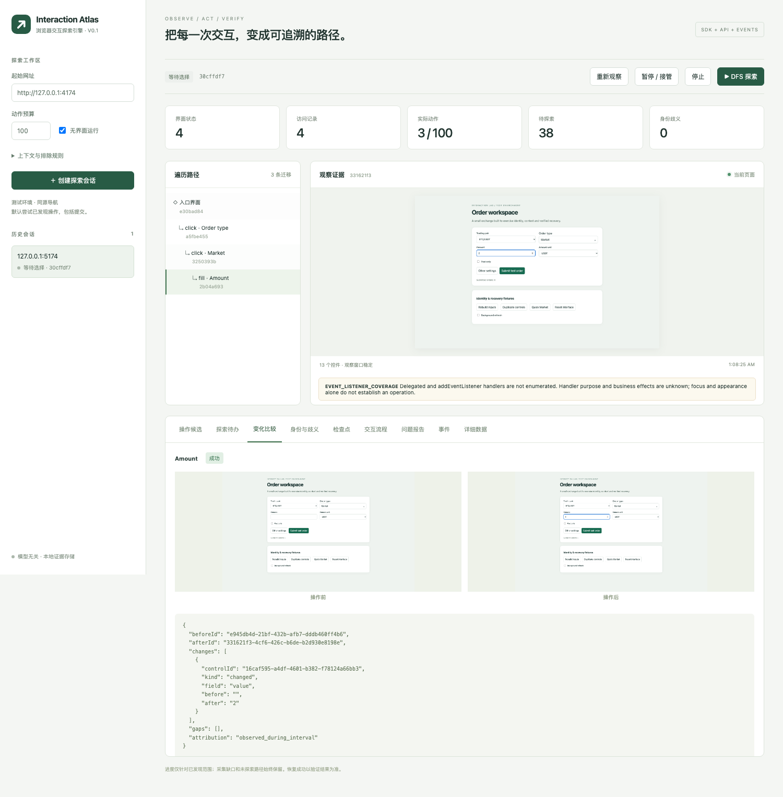

# 浏览器交互探索引擎 · V0.1

输入网址，得到可以查询、继续探索和验证到达结果的交互图。界面名称为 **Interaction Atlas**。项目已迁到 `~/Projects/browser-interaction-engine`。core 是独立于 Web 的 SDK，浏览器执行通过 Playwright 适配器接入；没有模型调用、提示词、模型管理或 Agent。



## 详细证据与快照订阅

事件 data 可保持简约。BrowserEngine / HTTP 客户端提供 observationDetails、controlDetails、regionDetails、dom、eventContext 和 evidenceArtifact，查询指定观察的文案、类型、状态、DOM 结构/属性、标签关系、ARIA、截图及运行记录。查询读取历史证据，不操作浏览器，也不推断业务意图。见 [证据接口、配置及限制](docs/EVIDENCE-API.md)。

观察事件支持直接交付详细快照（含截图），留存可选择临时交付、短期缓存或注入的持久插件。界面在“详细证据留存”设置策略，在“事件 → 事件交付 → 完整快照”打开事件内的历史数据；缓存释放不会改写已收到的快照。检查点可显式固定必要证据，缺失时返回 UNVERIFIED。用法见 [交付与留存](docs/EVIDENCE-API.md#事件直接交付快照)。

## 启动

需要 Node.js 24 和 pnpm 10。在项目目录运行：

```sh
cd ~/Projects/browser-interaction-engine
pnpm install --frozen-lockfile
pnpm browser:install
pnpm demo
```

首次安装完成后，`pnpm demo` 一条命令同时启动：

| 地址 | 用途 |
| --- | --- |
| http://127.0.0.1:5173 | 调试界面 |
| http://127.0.0.1:4174 | Limit / Market 测试站 |
| http://127.0.0.1:4173/v1/health | HTTP API |

在界面创建会话，再依次执行 `Order type → Market → Amount`，即可查看菜单关闭后的访问路径、逻辑身份和差异。取消“无界面运行”可以观察 Chromium，也可以人工登录后点击“重新观察”。默认策略会尝试提交等已发现操作，演示站的提交仅累加本地计数。

```sh
pnpm typecheck
pnpm test:core
pnpm test
pnpm build
pnpm report
```

`pnpm report` 自行启动测试站、执行一个完整示例，将实际结果和截图写入 `docs/run-report.md`、`docs/run-report.json`、`docs/run-evidence/`。已有测试结果见 [验收记录](docs/ACCEPTANCE.md)。

构建后可用 `pnpm start` 在 4173 端口同时提供 API 和编译后的界面；此命令不会启动测试站。数据默认放在 `.data/`，可用 `INTERACTION_DATA_DIR` 设置；`PORT` 设置服务端口。端口只监听 `127.0.0.1`。Linux 首次使用 Playwright 时可能需要通过 `pnpm exec playwright install --with-deps chromium` 安装系统依赖。

## 交付结构

```text
packages/core/                纯 SDK：图、身份、待办、队列、探索、恢复、hook、事件
packages/adapter-playwright/  Web 模型、DOM 观察/定位、浏览器操作及原生输入规则
packages/browser/             浏览器 SDK 的组合入口，不选择默认存储
packages/rules/               可配置控件检查插件：规则注册、目标绑定、逐控件证据与结论
packages/storage-retained/    证据生命周期插件：TTL、预算、固定与可用性
packages/storage-memory/      内存记录和二进制证据插件
packages/storage-sqlite/      SQLite 记录和文件证据插件
packages/client/              HTTP 客户端与 SSE 续读
apps/server/                  Fastify /v1 服务，仅应用层使用
apps/ui/                      React 调试界面
apps/test-site/               React / Portal / 原生控件测试站
examples/                     非网页 core 示例、外部策略和 hook
tests/                        分层约束、存储契约、核心及浏览器测试
PLAN.md / ROADMAP.md           发布契约与迭代范围
```

这是可直接运行和修改的 workspace；包尚未发布到 npm。各包通过自己的 `package.json` 声明依赖，`pnpm build` 会生成每个包的 `dist/`。依赖方向和插件契约见 [ARCHITECTURE.md](docs/ARCHITECTURE.md)。

操作发现区分原生能力、ARIA 声明与疑似行为；焦点、鼠标样式和弹窗文案不会兜底生成 click。疑似操作默认跳过，可明确试探或通过 hook 提供依据，见 [操作候选与证据](docs/ACTION-EVIDENCE.md)。

探索待办区分控件身份、具体输入样本和执行结果。SDK、HTTP 与策略 hook 提供结构化覆盖信息；调试页按同一控件及操作汇总，见 [待办与样本覆盖接口](docs/FRONTIER-COVERAGE.md)。

“身份与歧义”页展示待确认控件和相似记录的名称、类型、所在区域、局部截图与整页位置，并说明无法区分的原因。选择“独立控件”或“沿用候选记录”后，填写理由并保存；同时出现的不同控件不能合并。列表重排、重复控件及虚拟列表的匹配规则和限制见 [控件身份匹配](docs/IDENTITY-MATCHING.md)。

## 纯 core SDK

core 不依赖 Playwright、DOM、URL、文件系统、数据库或 HTTP。它接收调用方注入的交互适配器和存储插件，动作类型及参数也是通用的。计数器示例没有网页或浏览器：

```ts
import { InteractionEngine } from '@interaction/core';
import { MemoryStore } from '@interaction/storage-memory';
import { CounterAdapter } from './examples/counter-adapter.js';

const engine = new InteractionEngine({
  adapter: new CounterAdapter(),
  persistence: new MemoryStore(),
});
try {
  const session = await engine.createSession({ maxActions: 3 });
  await engine.explore(session.id);
  await engine.waitForIdle();
  console.log(engine.observation(session.id).count); // 3
} finally {
  await engine.close();
}
```

运行 `pnpm example:core` 可以执行这个示例。core 使用标准运行时的 UUID、定时器与结构化克隆，没有 Node 模块导入；自己的类型检查只使用 ES2023，排除了 DOM 和 Node 类型声明。

## 浏览器 SDK 与存储选择

浏览器能力组合在 `BrowserEngine` 中，调用方明确选择存储：

```ts
import { BrowserEngine } from '@interaction/browser';
import { MemoryStore } from '@interaction/storage-memory';
// 持久保存时可替换为：import { SqliteStore } from '@interaction/storage-sqlite';

const engine = new BrowserEngine({
  persistence: new MemoryStore(), // 或 new SqliteStore('./my-evidence')
});
try {
  const session = await engine.createSession({
    url: 'http://127.0.0.1:4174', headless: true,
    contextRules: [{ key: 'pair', selector: '#pair' }],
  });
  const checkpoint = await engine.createCheckpoint(session.id, '入口');
  const action = engine.actions(session.id).find(a => a.label === 'Order type')!;
  console.log(await engine.execute(session.id, action.id, crypto.randomUUID()));
  console.log(await engine.reachCheckpoint(session.id, checkpoint.id));
} finally {
  await engine.close();
}
```

内存插件将图、观察、事件、请求去重和截图字节保存在内存中，不创建项目数据目录；其内容不跨进程保留。SQLite 插件将记录保存为 SQLite、证据保存为文件。HTTP 的证据接口统一读取插件，因此两种方式都能配合调试界面。

所有写操作共用 core 的串行队列。普通查询读取插件中的事实，不操作交互源。原有 `(directory, hooks)` 构造方式改为显式的 `{ persistence, hooks }`；浏览器包保留 `InteractionEngine` 名称作为 `BrowserEngine` 的别名。纯 core 的 `InteractionEngine` 还要求注入 `adapter`。

跨进程使用 `InteractionClient`。`requestId` 由调用方为每个意图分配；重试同一请求须保留相同 ID 和参数。已经发出而结果未知的请求也只返回原记录，不再次执行。

```ts
import { InteractionClient } from '@interaction/client';
const client = new InteractionClient('http://127.0.0.1:4173');
const session = await client.createSession({ url: 'http://127.0.0.1:4174' });
const candidates = await client.actions(session.id);
const selected = candidates.find(a => !a.excluded && a.preconditions.identityResolved)!;
await client.execute(session.id, selected.id, crypto.randomUUID());
```

完整的“候选 → 选择 → 执行 → 查询歧义 → 裁决”示例为 [examples/external-strategy.ts](examples/external-strategy.ts)，在 `pnpm demo` 启动且没有其他活动会话时运行 `pnpm example:strategy`。这个示例使用测试站标签；引擎内部不包含这些标签或 ID。

引用事件使用 `client.events(sessionId, lastSequence, abortSignal)` 订阅；第四个参数 `{ delivery: 'inline' }` 交付完整观察快照。记录最后处理的 `sequence`，重连后从该序号续读；完整证据受留存窗口限制。进程内 `engine.subscribeEvents` 支持同样的投影，原有 `engine.events.on('event', listener)` 保持引用通知。

## 扩展边界

`new BrowserEngine({ persistence, hooks })` 接收动作发现、输入样本、业务上下文、分支选择、身份裁决、检查点验证、可接受状态、环境重置、动作后检查 hook。定义见 [core 类型](packages/core/src/types.ts) 和 [Web 扩展类型](packages/adapter-playwright/src/types.ts)，示例见 [hooks.ts](examples/hooks.ts)。

Hook 接收事实副本和稳定 ID，不接收浏览器元素句柄。返回值记录来源和依据，异常形成 `hook.error`；依赖失败结果的分支受阻。单次 hook 超时为 5 秒，异步代码应自行处理取消，不能依靠超时停止外部副作用。

HTTP 调用方通过命令提交选择、输入、裁决和检查点条件；自定义可执行 hook 安装在运行引擎的服务进程。界面和外部 SDK 使用同一个 API、会话及执行器。

## 语义和边界

- `Observation` 不可覆盖；`UIState` 按 `observable-v5` 契约归组（历史观察保留原版本）；`Transition` 构成图，`Visit` 保留每次访问和父路径。指纹相同后还会比较规范化内容。
- 状态契约包含 URL、控件语义和状态、约束、选项、滚动、声明的上下文及关键缺口。截图像素、完整页面文字和服务器数据不用于自动等价。需要影响验证的业务值，应声明为 context 或提供 verifier。
- DOM / ARIA 是采集到的语义事实，不是完整浏览器可访问性树。稳定等待针对被观察控件；稳定只代表有界观察窗口，不保证业务完成或截图与属性原子一致。
- 控件身份采用带区域作用域的稳定标识和唯一语义候选；没有位置近似自动绑定。歧义产生临时身份、候选和修订记录，旧观察不重写。页面重新加载后，之前依靠 DOM 实例作出的人工判断可能需要重新裁决。
- 全站业务上下文未声明时只知道可观察事实；声明但无法采集的上下文标为未知并阻止依赖动作。输入检查原生形状约束，不推断业务有效性。
- 恢复每步验证。`REACHED_VERIFIED` 只表示检查点契约通过；`REACHED_ACCEPTABLE` 必须有显式接受条件；其余为前提变化、不可达或未验证。重建浏览器不重置服务器。
- 未知用途和提交动作默认不重放，首次探索仍可执行。显式 replayable 规则允许重放已知路径；可能发生业务写入后，从入口重开仍要求环境重置证据。
- 单进程、单活动会话、单标签页。历史可查询；停止当前会话后可以继续历史会话，重新打开入口会重新观察，不声称恢复旧业务世界。不要用多个服务进程同时操作同一数据目录。
- iframe、Shadow DOM、Canvas、上传下载、新标签、原生弹窗的内部流程不探索。可检测到的限制写入 gaps；关闭的 Shadow Root 无法仅从标准 DOM 完整检测。
- 持久化由插件提供。SQLite 模式先持久化执行意图，结果和图更新事务提交；崩溃后的执行中动作变为 `unknown`。内存模式也保留事务和去重语义，但进程结束后数据丢失。
- 默认预算 100 次实际动作、深度 10、运行 10 分钟；恢复也计入。结束报告只描述已发现范围，不能表示全站探索完成。

更详细的数据关系、HTTP 协议和恢复结果见 [docs/API.md](docs/API.md)。后续增强见 [ROADMAP.md](ROADMAP.md)。

### 弹层优先探索

Modal、popover 与浮动菜单建立独占交互范围，DFS 先探索当前最内层范围，验证关闭后才继续父页面。调试界面显示范围链与受阻原因；无法退出时暂停并保留待办。规则、事件和本地测试入口见 [弹层优先探索](docs/INTERACTION-BOUNDARIES.md)。

差异详情查询与上层集成：见 [docs/DIFF-DETAILS.md](docs/DIFF-DETAILS.md)。支持按观察、动作、事件或流程一次读取前后控件、身份依据、操作、业务上下文及截图引用；调试页面同步提供解释和定位。

## UI 检查支撑

`main` 已提供初始/操作后检查任务、弹层范围与前后基线、常规空间证据、有限消费租约及 SDK/HTTP 接口。创建会话时传 `inspection: {}` 开启；外部检查规则与接入方式见 [UI 检查 API](docs/INSPECTION-API.md)。显式 hover/focus probe、组件关系和局部证据查询见 [复合控件与探测](docs/COMPONENTS-AND-PROBES.md)。中间态、文字行与 iframe/Shadow DOM 取证仍为后续工作。

可选的 `@interaction/rules` 插件支持按配置或上层 Agent 选择版本化规则，保存逐控件的 pass/fail/unknown/not-applicable 与严重度。首条 `sampled-occlusion` 只检查历史采样点命中，遮挡待核实时输出 warning，不将 sticky/fixed 或滚动到底直接判断为 error。规则写法、当前边界与接入示例见 [控件检查规则](docs/CONTROL-RULES.md)。

推荐使用 `ObservedOcclusionTracker` 跟随正常探索进行异步复查：通过逻辑控件身份、业务上下文和弹层打开周期关联历史警告，核对实际祖先滚动位置，再记录恢复或继续待确认。只有调用方明确声明某控件在各观测位置必须满足五点指针要求，且相关滚动后的可比证据仍失败，才升级为该约定下的 error。规则不会发起动作或恢复滚动位置。探索器已支持页面、modal 内部和嵌套容器的双轴滚动。见 [持续复查示例](examples/observed-occlusion-inspector.ts)。

`clipped-control` 检查控件是否被祖先容器的矩形边界裁剪。普通滚动中的部分可见保持待复查；`hidden/clip` 裁剪先报 warning，有明确身份绑定要求时才报 error。`ClippedControlTracker` 可随探索快照持续跟踪，只有同一控件的可比证据恢复完整才关闭问题；移出视口、缺证和重建不会直接消除警告。见 [裁剪检查示例](examples/clipped-control-inspector.ts) 与 [规则范围](docs/CONTROL-RULES.md#裁剪规则-clipped-control)。

显式调用 `scroll-recovery` 可探测双轴和嵌套滚动，验证同一控件是否恢复命中并尝试恢复原位置；经过确认的恢复为 warning，有明确当前操作要求且五点被挡、无可用滚动路径时为限定范围的 error。有限探测失败、目标变化和恢复位置失败保留 unknown。见 [主动检查示例](examples/scroll-recovery-inspector.ts)。

浏览器新会话默认覆盖已遇到控件及其支持操作；控件计数、代表性/逐状态模式、当前节点定位、局部恢复声明和环境重置边界见 [探索与恢复](docs/EXPLORATION-RECOVERY.md)。

上层可通过持久事件、`controlReview` hook 或 SDK/HTTP 审阅未知控件的当前操作，提供来源、用途证据及样本；支持替换、撤销及条件变化失效，独立于探索深度决定。见[控件审阅](docs/CONTROL-REVIEW.md)。

报告 `explorationAudit` 区分实际成功、明确不测、待决、待执行、阻塞和过时意图，并保留判断依据。当前范围已处理不等于发现完整，更不等于整页所有行为均已验证；见[操作审计](docs/EXPLORATION-AUDIT.md)。

新浏览器会话默认先覆盖入口页面；跳到其他页面后交由上层决定，未批准时尝试沿已验证历史返回。DFS 不会默认在 B 消耗剩余预算，允许 B 也不会自动允许 C。可用 `pageExploration: 'all'` 显式启用跨页探索；调试页提供页面范围选择和目的页决策。见[页面范围](docs/EXPLORATION-DECISIONS.md#页面范围优先于-dfs-顺序)。

上层可读取统一范围材料，按观察来源查看入口与重叠约束，用一次版本绑定的批量决定选择穷尽、样本、暂缓或本轮不测。支持 `explorationReview` hook、SDK/HTTP 以及调试页“范围决策”；任一版本过期整批拒绝，未来新范围独立决定。见[批量审阅协议](docs/EXPLORATION-DECISIONS.md#统一审阅材料与批量决定)。

对于缺少语义区域的页面，可启用 `regionExploration: 'review'`，先按容器、标题和布局审阅探索区域，再选择探索深度。支持合并、拆分、拒绝和结构变化失效；调试页可生成划分草稿。见[区域候选审阅](docs/REGION-REVIEW.md)。

通用探索决策允许上层按业务目标选择深入、指定样本、暂缓或本轮跳过。支持自定义范围 hook，以及可选区域、入口分支和输入样本识别；条件变化需新决策，跳过不计覆盖。见[通用探索决策](docs/EXPLORATION-DECISIONS.md)。

相似列表默认先交由上层决定遍历范围：支持持久事件、`explorationGroup` hook 和 SDK/HTTP 决策，等待期间暂缓列表并继续其他工作。穷尽、指定抽样、暂缓的契约和未覆盖口径见[列表遍历决策](docs/LIST-EXPLORATION.md)。
