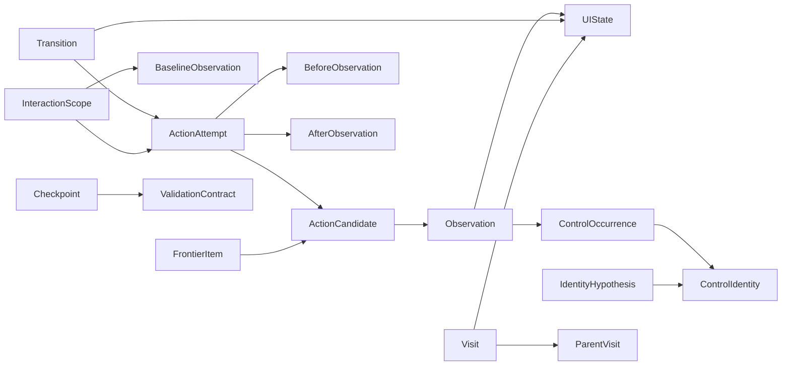

# 浏览器 HTTP API 契约

本协议属于 `apps/server`，HTTP 客户端位于 `packages/client`。纯 core SDK 不包含 HTTP、SSE 或 URL 协议；其适配器和存储边界见 [ARCHITECTURE.md](ARCHITECTURE.md)。

## 数据关系



`UIState` 是等价组，`Visit` 是具体访问。`Observation.controls` 中的 `identityId` 引用逻辑身份；`instanceId` 是当前 document 内的实例线索；`hypothesisId` 表示需要裁决。裁决修改假设并生成新观察，旧观察不可覆盖。

`observable-v1` 使用 URL、按 DOM 顺序的控件语义/值/状态/约束/选项、上下文、滚动和关键缺口作为规范化投影。位置、截图和 DOM 实例不直接决定状态等价。关键缺口存在时不自动归并状态。该投影不是完整业务状态；应用相关条件需要 context 和验证 hook。

## HTTP

默认基础地址 `http://127.0.0.1:4173/v1`。数据契约和命令验证与进程内 SDK 共用 `packages/adapter-playwright/src/types.ts`、`schema.ts`，通用实体继承自 `packages/core`。

| 方法 | 路径 | 作用 |
| --- | --- | --- |
| GET | /health | 版本与健康状态 |
| GET / POST | /sessions | 历史会话 / 创建会话 |
| GET | /sessions/:sid | 会话与预算 |
| POST | /sessions/:sid/commands | 统一命令入口 |
| GET | /sessions/:sid/observation?id= | 当前或指定历史观察 |
| GET | /sessions/:sid/actions?observationId= | 当前或历史候选 |
| GET | /sessions/:sid/graph | states、transitions、visits |
| GET | /sessions/:sid/compare?before=&after=&region= | 单步或区域比较 |
| GET | /sessions/:sid/compare/details?before=&after=&region= | 比较并关联完整历史证据 |
| GET | /sessions/:sid/attempts/:attemptId/diff/details | 动作保存的 diff 详情 |
| GET | /sessions/:sid/events/:sequence/diff/details | 事件保存的 diff 详情 |
| GET | /sessions/:sid/scopes/:scopeId/diff/details | 流程累计 diff 详情 |
| GET | /sessions/:sid/path?from=&to= | 已记录可重放路径；无路径为 null。多观察图分组须同时指定 fromObservationId、toObservationId；按严格观察连续性寻路，不以图分组相同证明到达 |
| GET | /sessions/:sid/report | 发现范围、动作、待办、缺口和问题 |
| GET | /sessions/:sid/evidence/:observationId | PNG 截图 |
| GET | /sessions/:sid/events?after= | SSE；支持 Last-Event-ID |
| GET | /sessions/:sid/events?format=json&after= | 持久化事件批次，最多 1000 条 |

集合资源：`observations`、`states`、`visits`、`attempts`、`frontier`、`identities`、`hypotheses`、`scopes`、`checkpoints`、`issues`、`recoveries`。路径为 `/sessions/:sid/<resource>`，支持 `status`、`offset`、`limit`，默认 200，最多 1000；返回 `{items,total,offset,limit}`。

会话创建示例：

```json
{
  "url": "http://127.0.0.1:4174",
  "headless": true,
  "maxActions": 100,
  "maxDepth": 10,
  "maxDurationMs": 600000,
  "contextRules": [{"key":"pair","selector":"#pair"}],
  "exclude": [{"name":"Submit test order"}],
  "replayable": []
}
```

过滤规则可组合 `role`、`name`、`stableKey`、`kind`、`urlIncludes`。同一规则各字段为 AND，规则数组为 OR；name 是精确匹配。storageState 可为 Playwright 文件路径或对象。单会话限额在创建时确定；暂停/继续不重置预算。

## 命令

以下 JSON 为各命令形状，ID 使用接口返回值：

```json
{"type":"observe"}
{"type":"inspect","region":"form:order-form"}
{"type":"execute","actionId":"...","requestId":"caller-unique-id","value":"2"}
{"type":"explore"}
{"type":"pause"}
{"type":"resume"}
{"type":"stop"}
{"type":"resolveIdentity","hypothesisId":"...","identityId":"...","source":"human","evidence":["业务记录和控件职责一致"],"guard":{"observationId":"...","revision":0}}
{"type":"openScope","name":"订单设置","region":"form:order-form"}
{"type":"closeScope","scopeId":"..."}
{"type":"createCheckpoint","name":"Market 表单","predicates":[],"acceptable":[]}
{"type":"reachCheckpoint","checkpointId":"..."}
```

`inspect` 进行新的事实采集，不滚动、不展开，返回观察与指定区域控件。需要交互的补充信息通过显式 execute 获取。恢复的入口重开内部记录为 `navigate`；HTTP 调用方不能用这个类型任意跳转。

`pause`、手动 `execute`、身份裁决和到达检查点会请求默认策略暂停，排队等待当前步骤完成。`explore` / `resume` 开始默认策略后立即返回，进度从事件和待办读取。到达调用返回最终 `ReachResult`。

## 前提、错误和幂等性

动作 ID 属于特定 observation；旧 ID 不按相似选择器自动迁移。执行前重读 DOM 和上下文，过期时抛出 `STALE_OBSERVATION` 或 `PRECONDITIONS_CHANGED`，details 提供新 observationId，必要时也包含新 candidates。`IDENTITY_AMBIGUOUS`、`ACTION_EXCLUDED`、`INVALID_INPUT`、`INPUT_REQUIRED`、`BUDGET_EXHAUSTED` 和 `ACTIVE_SESSION` 表达不同阻断原因。

错误格式为 `{error:{code,message,details?}}`。无效请求体为 HTTP 400，记录不存在 404，操作/前提冲突通常为 409，意外错误 500。浏览器执行已经开始后，以持久化 `ActionAttempt` 返回 succeeded、failed 或 unknown；`failed` 表示驱动执行失败，不证明服务器绝无副作用。

`requestId` 在会话内唯一。相同请求和参数返回原 attempt；参数不同返回 `REQUEST_CONFLICT`。崩溃后原请求的未知结果也不重试。外部可检查事实并发起新的明确意图。

## 检查点

检查点默认验证保存时的完整观察契约（新观察为 `observable-v6`）投影与已知业务前提，可以增加：

```json
{"target":"url","equals":"http://127.0.0.1:4174/"}
{"target":"context","key":"pair","equals":"BTC/USDT"}
{"target":"control","identityId":"...","field":"value","equals":"2"}
```

控件 predicate 支持 value、checked、visible、enabled；上下文未知、控件歧义或关键采集缺口不能被当作验证通过。`acceptable` 是调用方另行允许的状态契约；只能在已知业务前提未改变的条件下接受。

| status | 处理方式 |
| --- | --- |
| REACHED_VERIFIED | 可在检查点契约范围内继续 |
| REACHED_ACCEPTABLE | 根据调用方允许的新状态继续 |
| PRECONDITIONS_CHANGED | 重新选择路径或修订业务条件 |
| UNREACHABLE | 查看 reason 和 remainingFrontier，修复路径或提供真实环境重置 |
| UNVERIFIED | 补充观察、等待稳定或修复验证证据 |

恢复用同一执行器和预算，路径每一步比较记录的目标投影，偏离停止。reset hook 应真正重置业务环境并返回 `{reset:true,evidence:[...]}`；仅返回成功不会替调用方执行重置。调用方提供 verifier/accept hook 时仍保留引擎自身的观察检查。

## 事件、Hook 和保存

事件包括 `session.*`、`observation.created`、`observation.external_change`、`observation.diff`、`action.started/completed/unknown`、`identity.ambiguous/resolved`、`frontier.updated`、`scope.opened/closed`、`checkpoint.created/result`、`exploration.*`、`environment.reset`、`hook.error`、`issue.reported`。

SSE 的 id 等于持久化 sequence。序号全库递增，因此单会话序列可能不连续。客户端按序号去重，断线后读取大于已处理序号的事件，不依赖内存通知重建进度。

SQLite 插件使用 WAL，`entities` 保存带 kind 的结构化实体，`events` 保存追加日志，`requests` 保存意图去重映射，metadata 保存 schemaVersion=1。执行意图与预算/待办在一次事务内落盘；执行结果、观察、状态、迁移、访问和事件在另一事务内关联。默认文件证据插件将图片先保存到 evidence 文件夹；崩溃可能留下未引用图片，不会把未提交结果当作成功。

公开的通用 TypeScript Hook 类型位于 `packages/core/src/types.ts`，输入样本等 Web 扩展位于 `packages/adapter-playwright/src/types.ts`，编译时检查返回值；动作、输入和上下文的运行时边界也验证其结构。Hook 异常记录 `hook.error`。普通观察事实先保留，依赖失败 hook 的操作受阻；动作后检查失败不改变已经记录的浏览器结果。

内存插件保留同样的实体、请求去重、事件游标和事务语义，证据通过 `EvidenceStore.get()` 返回字节。`/evidence` 不依赖本地路径。内存数据不跨进程保存。

详细响应、历史语义及 SDK/Event 用法见 [DIFF-DETAILS.md](DIFF-DETAILS.md)。
## 详细证据接口

按事件、观察、控件及区域读取不可覆盖的历史证据，见 [详细证据查询](EVIDENCE-API.md)。新接口只读，不调用浏览器，不改变现有 SSE data 结构。

## 操作依据与试探

候选返回 `basis: {status: 'supported' | 'tentative', evidence: [{source, rule, facts}]}`，与当前前提和实际结果分别记录。疑似操作保留在操作候选中，默认探索跳过（controls 不生成探索待办；其他模式保留阻塞待办），并发出 `action.tentative`（actionId、observationId、basis）。外部明确 execute 可试探，仍检查最新观察和执行前提，不自动重放。原始控件保存 `actionBasis`、`interactionHints` 和命中的 `discovery`；无操作的元素仍可查询。详见 [操作候选与证据](ACTION-EVIDENCE.md)。

## 探索与恢复配置

未知控件可通过 `controlReview` hook 或 SDK/HTTP 提交带来源的持久操作审阅。`control.review_requested` 通知上层读取当前材料；审阅支持替换、撤销及条件变化失效，独立于探索范围批准。完整字段及限制见[控件审阅协议](CONTROL-REVIEW.md)。

新会话同时默认 `listExploration: 'review'`。相似列表通过 `exploration.group_detected` 持久事件或 `hooks.explorationGroup` 提交给上层，暂缓成员及所属列表滚动，优先继续其他工作。`GET /v1/sessions/:sessionId/exploration-groups` 查询材料；`decideExplorationGroup` 命令接收 groupId、revision、decision（all/sample/defer/skip，附 source/evidence）。未执行成员仍计入缺口；无其他工作时以 `LIST_DECISION_REQUIRED` 暂停。详见[相似列表遍历决策](LIST-EXPLORATION.md)。

通用范围复用以上查询、事件与命令：`hooks.explorationScopes` 提出任意 kind 的当前动作范围，`hooks.explorationDecision` 返回决策（优先于兼容 hook）。浏览器 `decisionScopes` 可选 region/branch/input-space，默认不启用。`skip` 为本轮不测，状态 skipped；`defer` 在其他工作结束后以 EXPLORATION_DEFERRED 暂停。通用范围条件失效会发布 exploration.group_invalidated，旧决策不可重用。完整语义见[通用探索决策](EXPLORATION-DECISIONS.md)。

新会话默认 `pageExploration: 'review'`，DFS 优先入口页；目的页产生 `kind: page` / `binding: context` 的同协议范围。待决时通过已验证原生历史返回来源页；批准 B 不批准 C。`all` 显式采用跨页探索，旧会话缺少字段保持原行为。新增暂停原因 PAGE_DECISION_REQUIRED、PAGE_EXPLORATION_DEFERRED、PAGE_RETURN_BLOCKED；返回事件 exploration.page_returned / page_return_blocked，报告增加 pageExploration。返回事件的 stateRestored 为 false，不表示旧业务状态恢复。完整语义见[页面范围](EXPLORATION-DECISIONS.md#页面范围优先于-dfs-顺序)。

用途审阅复用与探索决策独立。`GET /v1/sessions/:sessionId/exploration-groups/:groupId/purpose-material` 输出当前条件与成员，上层通过 `reviewListPurpose` 命令提交用途、业务范围、来源和依据，再 observe 使新候选使用判断。`GET /v1/sessions/:sessionId/purpose-reviews` 查询持久记录；`revokePurposeReview` 撤销后会拦截尚未派发的动作。相应 SDK 方法同名，记录、失效与撤销都有 `purpose.review_*` 事件。每项仍校验当前目标并保留独立执行记录，条件变化后不复用；详情见[用途审阅复用](LIST-EXPLORATION.md#穷尽与用途审阅复用可以同时启用)。

新浏览器会话默认 `exploration: controls`，也支持 `representative` 和 `stateful`。`report.controlCoverage` 提供独立控件操作覆盖；`target` / `preconditions.targetResolved` 区分当前节点定位与历史身份。interfaceActions、reversible 和 environmentReset 是可选应用声明。待办 sampling 标识抽样范围；superseded 表示有证据支持的调度退役，不表示执行成功。恢复 diagnostics 标识业务副作用来源与恢复路径。SDK/HTTP/client 共用这些字段。详见 [探索与恢复](EXPLORATION-RECOVERY.md)。

支持的旧 representative 未执行采样范围在新观察时按保留来源核验迁移；`samplingMigration` / `samplingParents` 记录父子关系，完整转交时 `coverage.migratedTo` 区分账务退役和成功覆盖。缺失、歧义、未知来源继续保留缺口，既有执行结果不转换。普通读接口不执行迁移。详见 [旧采样范围接续](FRONTIER-COVERAGE.md#旧采样范围接续)。

SDK `await engine.reconcileSamplingScopes(sessionId)` 显式重核修复后的保留来源，返回带迁移记录的待办；该调用不打开浏览器、不创建观察、不派发操作，仍拒绝未解决的 unknown。常规观察缓存未变化的迁移核验，避免每次动态刷新重读全部历史来源。此入口目前仅提供 SDK 方法，没有新增 HTTP 命令。

## 复合控件、外部解释和主动探测

`Observation.components` 保留组关系和独立成员，`componentDetails` 提供有界局部证据及历史引用。`describeComponent` 保存来源解释，不覆盖观察；`probe` 支持显式 hover/focus，共用动作队列、前提、预算、去重与前后采集。接口、校验和能力限制见 [复合控件与探测](COMPONENTS-AND-PROBES.md)。
