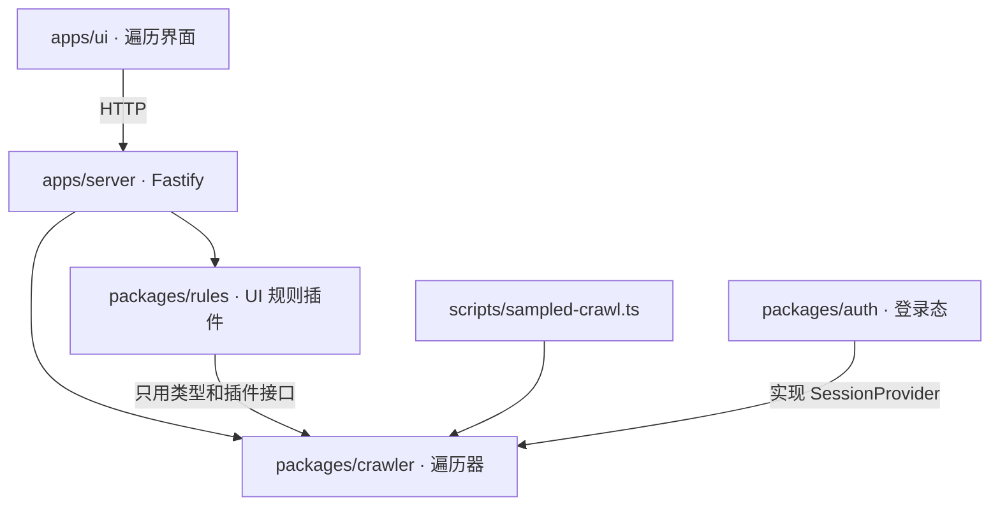

# 结构与插件契约

## 包及依赖方向



| 包 | 负责 |
| --- | --- |
| `@interaction/crawler` | 浏览器驱动与页面抓取、会话接口与 A/B 实验会话、抽象状态、控件类与列表抽样、动作选择与回退、跳转拦截、模型判断（JEV/LLM）与计费、输入分类、目标模式、运行存储（SQLite）、续跑、插件接口 |
| `@interaction/rules` | UI 规则（遮挡、裁切、文字截断、图片资源、图片比例、文字与背景同色）与跨状态跟踪；`rulesPlugin()` 把它们接成遍历插件 |
| `@interaction/auth` | 登录快照导入（解密、命名映射、重新加密）、登录心跳 + 匿名对照验证、账号库与占用锁；`PresetAuth.provider()` 是一个 `SessionProvider` |
| `apps/server` | `/v1/crawls` 路由；按名字提供插件（目前是 `rules`）和会话（目前是 `experiment`），每次运行由请求选择 |
| `apps/ui` | 发起/停止/续跑遍历，查看动作、状态截图、覆盖统计和插件结果 |
| `apps/test-site` | 本地演示站与规则夹具页 |

遍历器不导入规则包。是否检查、检查什么，由组装层（服务端、命令行脚本）决定。

## 遍历器

- **只测当前页**：主文档跳转用 Playwright 路由拦截并记录；同文档的 hash/history 变化记为低优先级。
- **抽象状态**：状态键由 URL、打开的弹层和可见控件类组成，数字被遮蔽，价格变动不产生新状态。
- **控件类与抽样**：同一组件结构的控件归为一类，每类只执行少数几个；列表按结构识别，只测前几项。
- **回退**：优先浏览器后退，否则直接重新加载入口页再重放到目标状态；没有效果的动作会从重放路径中剪掉。
- **模型**：程序信号弱时，先问 JEV（是否值得点、动作效果、输入类型），不确定时才用 LLM；调用次数和费用计入汇总。

## 插件接口

```ts
interface CrawlPlugin {
  id: string;
  onState(context: CrawlStateContext): Promise<Finding[]> | Finding[];
  onEnd?(): Promise<Finding[]> | Finding[];
}
```

`onState` 在每个新状态上调用一次，只读不写：`context` 提供状态键、序号、URL、遍历用的抓取、`page`、按需的详细抓取 `detail()`（样式、布局、文字几何，只有插件需要时才抓）和运行记录 `runtime()`。同一插件、规则、元素和文本的问题每次运行只报一次；插件抛错记为 `plugin_error` 事件，不影响遍历。

`rulesPlugin(options)` 把每个状态的详细抓取组装成规则读的 `RulePage`，依次运行规则跟踪器，默认只上报 warning 和 error。

## 会话接口

```ts
interface SessionProvider {
  id: string;
  resumeKey?: string;                         // 会改变页面内容的状态（实验分组）：续跑必须相同
  prepare(target: { url; viewport }): Promise<PreparedSession>;
}
interface PreparedSession {
  describe: Record<string, unknown>;          // 进事件和汇总，不放密钥
  context: SessionContextOptions;             // storageState、UA、语言、触摸……视口尺寸仍由遍历决定
  headers?: { domains; headers }[];           // 只对匹配域名加的请求头
  pinnedCookies?: Cookie[];                   // 整个运行期间保持该值
  initScripts?: string[];
  writes?: { cookies?; localStorage? };       // init 脚本写入的键名，供其他会话保存时排除
  check?(page): Promise<{ ok; reason?; facts? }>;
  recheckMs?: number;
  release({ context?, verified, foreign? }): Promise<void>;  // 必定调用一次；foreign 是其他会话写入的键
}
```

- **顺序**：浏览器启动前依次调用各提供者的 `prepare`；任何一个抛错，已准备的都会 `release`，运行失败且不启动浏览器。
- **合并**：`composeSessions` 把多个会话合成一个 context：存储合并；同名冲突报错（规则见 README）。
- **作用域**：按域名的请求头和钉住的 cookie 由驱动在一个 context 路由里改写请求。该路由最先注册，所以最后执行，看到的是最终发出的请求；遍历器自己的路由用 `fallback` 交给它。cookie 还会在响应 `Set-Cookie` 后重新写回 jar，并在页面里拦截 `document.cookie` / `cookieStore` 的写入，保证页面读到的也是钉住的值。
- **复查**：入口页加载后对每个会话立即 `check`，之后每个动作前按各自的 `recheckMs` 复查；任一失败记 `session` 事件并以 `session_invalid` 停止。汇总里的 `sessions` 列出每个提供者是否全部通过、检查了几次。
- **续跑**：`CrawlManager` 把所有 `resumeKey` 记在运行选项 `sessionKeys` 里，续跑时必须一致。

## 规则

每条规则读一次不可变的详细抓取，输出逐目标的 `pass`、`fail`、`unknown` 或 `not-applicable`。证据不完整（抓取被截断、字体未加载、布局不稳定等）时判为 `unknown`，不会当作通过。跟踪器按状态顺序接收抓取，跟踪同一控件跨状态的问题：恢复记为 resolved，控件被替换或文本改变时保留历史结果，不当作恢复。

产品要求（例如"这张图必须保持比例"）只能由宿主以精确绑定的 requirement 传入，页面上的属性或模型提议不会直接改变判定。
