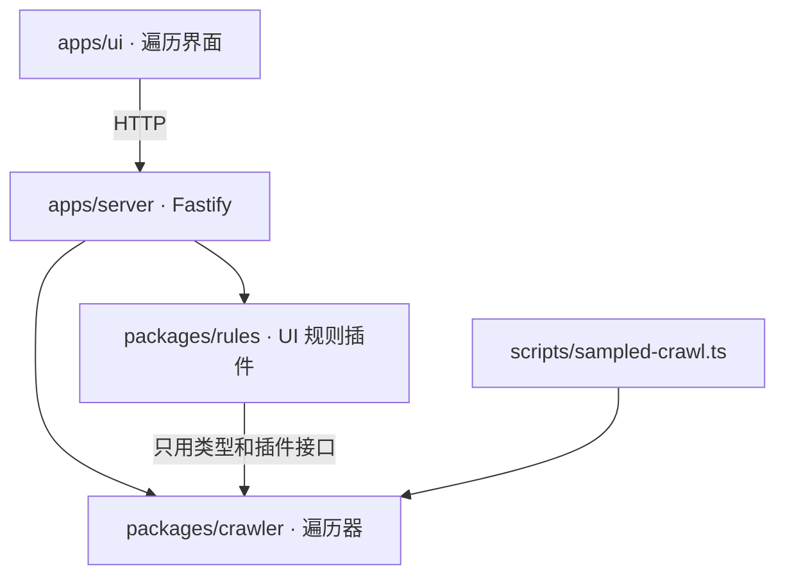

# 结构与插件契约

## 包及依赖方向



| 包 | 负责 |
| --- | --- |
| `@interaction/crawler` | 浏览器驱动与页面抓取、抽象状态、控件类与列表抽样、动作选择与回退、跳转拦截、模型判断（JEV/LLM）与计费、输入分类、目标模式、运行存储（SQLite）、续跑、插件接口 |
| `@interaction/rules` | UI 规则（遮挡、裁切、文字截断、图片资源、图片比例、文字与背景同色）与跨状态跟踪；`rulesPlugin()` 把它们接成遍历插件 |
| `apps/server` | `/v1/crawls` 路由；按名字提供插件（`rules`、`checks`），每次运行由请求选择 |
| `apps/ui` | 发起/停止/续跑遍历，查看动作、状态截图、覆盖统计和插件结果 |
| `apps/test-site` | 本地演示站与规则夹具页 |

遍历器不导入规则包。是否检查、检查什么，由组装层（服务端、命令行脚本）决定。

## 遍历器

- **只测当前页**：主文档跳转用 Playwright 路由拦截并记录；同文档的 hash/history 变化记为低优先级。
- **抽象状态**：状态键由 URL、打开的弹层和可见控件类组成，数字被遮蔽，价格变动不产生新状态。
- **控件类与抽样**：同一组件结构的控件归为一类，每类只执行少数几个；列表按结构识别，只测前几项。
- **回退**：优先浏览器后退，否则直接重新加载入口页再重放到目标状态；没有效果的动作会从重放路径中剪掉。
- **模型**：程序信号弱时，先问 JEV（是否值得点、动作效果、输入类型），不确定时才用 LLM；调用次数和费用计入汇总。

## 插件接口

```ts
interface CrawlPlugin {
  id: string;
  onState(context: CrawlStateContext): Promise<Finding[]> | Finding[];
  onEnd?(): Promise<Finding[]> | Finding[];
}
```

`onState` 在每个新状态上调用一次，只读不写：`context` 提供状态键、序号、URL、遍历用的抓取、`page`、按需的详细抓取 `detail()`（样式、布局、文字几何，只有插件需要时才抓）和运行记录 `runtime()`。同一插件、规则、元素和文本的问题每次运行只报一次；插件抛错记为 `plugin_error` 事件，不影响遍历。

`checksPlugin` 是内置的轻量示例。`rulesPlugin(options)` 把每个状态的详细抓取组装成规则读的 `RulePage`，依次运行规则跟踪器，默认只上报 warning 和 error。

## 规则

每条规则读一次不可变的详细抓取，输出逐目标的 `pass`、`fail`、`unknown` 或 `not-applicable`。证据不完整（抓取被截断、字体未加载、布局不稳定等）时判为 `unknown`，不会当作通过。跟踪器按状态顺序接收抓取，跟踪同一控件跨状态的问题：恢复记为 resolved，控件被替换或文本改变时保留历史结果，不当作恢复。

产品要求（例如"这张图必须保持比例"）只能由宿主以精确绑定的 requirement 传入，页面上的属性或模型提议不会直接改变判定。
