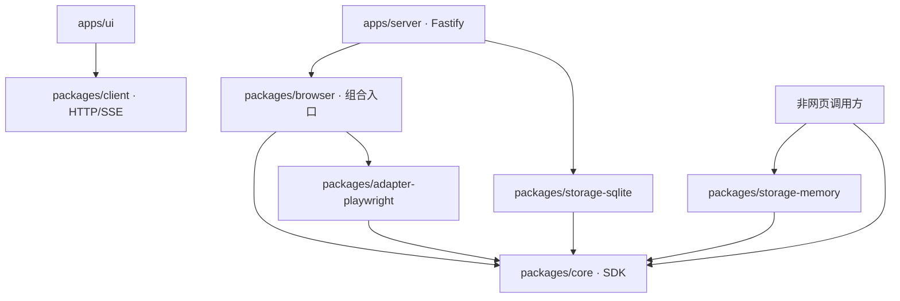

# 项目结构与插件契约

项目位置：`~/Projects/browser-interaction-engine`。此次重构保留原有浏览器探索行为，将依赖方向改为“应用组合插件，插件实现 core 声明的接口”。

## 包及依赖方向



| 包 | 负责 | 不负责 |
| --- | --- | --- |
| `@interaction/core` | 交互图、身份历史、歧义、访问路径、待办、串行执行、DFS、预算、检查点、恢复、hook 与进程内事件 | DOM、浏览器、文件、数据库、HTTP、SSE |
| `@interaction/adapter-playwright` | Web 类型扩展、URL 与认证配置、DOM/ARIA 采集、定位、点击填写、输入约束、菜单/弹窗识别、Web 等价规则 | 调度策略、数据库、HTTP 服务 |
| `@interaction/browser` | 把 core 与 Playwright 适配器组合成 `BrowserEngine`，提供浏览器命令契约 | 默认存储选择、HTTP 服务 |
| `@interaction/storage-memory` | 内存事务记录、事件日志、请求去重、二进制证据 | 浏览器、文件、SQL |
| `@interaction/storage-sqlite` | SQLite 事务记录、事件日志、请求去重、文件证据 | 浏览器执行、HTTP |
| `@interaction/client` | 浏览器 HTTP 客户端与 SSE 续读 | core 执行器 |
| `apps/server` | Fastify 路由、状态码、SSE、静态界面与服务生命周期 | 核心算法 |

core 的运行依赖只有 `zod` 和 `@noble/hashes`，没有 Node 模块导入，也没有 DOM 类型。它使用标准运行时提供的 UUID、结构化克隆、微任务和定时器。`packages/core/tsconfig.json` 使用 ES2023 且 `types: []`；构建中的分层测试防止引入平台和传输依赖。

## core 的模型

core 的 `Observation` 只要求控件、区域、上下文、时间、缺口和图引用。`Control` 只表达逻辑职责和状态；它没有 selector、tag、form、原生输入约束等字段。`instanceScope` 标识一次交互源实例的作用域，不预设 document。

平台通过泛型扩展观察和会话选项。例如 Web 观察追加 URL、DOM 实例、视口、滚动、截图引用和原生约束；计数器观察只追加 `count`。`ActionCandidate.kind` 为适配器定义的字符串，`value` 可为 JSON 对象；core 不识别 click、fill 或 select。

core 负责保留历史并应用确定性的身份关联流程。具体语义签名、状态规范化、字段差异和谓词解释由适配器提供；core 负责确认指纹及规范化内容、更新图和待办。默认浏览器适配器使用 `observable-v2`，把弹层范围和可操作性证据纳入观察等价；旧观察保留原始规则版本。

## 交互适配器

公开接口位于 [ports.ts](../packages/core/src/ports.ts)。

- `InteractionAdapter` 提供选项校验、驱动创建、身份签名、状态等价、比较、动作约束、谓词和重放匹配。流程范围和回退动作是可选能力。
- `InteractionDriver` 管理一个活动交互源，负责 start、capture、discover、preflight、validate、execute、reopen、close。
- core 在执行前调用 preflight / validate，先通过存储插件提交意图，再调用 execute，之后更新事实及图。适配器无需另建一套待办或恢复记录。
- 重开入口通过 `recovery-entry` 动作记录，仍受预算和重放约束限制。驱动的 reopen 只重建交互源，不被解释为重置业务世界。

完整的非网页适配器见 [counter-adapter.ts](../examples/counter-adapter.ts)。运行 `pnpm example:core`，只用 core 和内存插件就能执行、探索、比较和验证恢复。

## 持久化插件

`new InteractionEngine({ adapter, persistence, hooks })` 必须明确注入插件，没有隐式 SQLite、路径或内存默认值。`new BrowserEngine({ persistence, hooks })` 也不选择默认存储。默认演示和 HTTP 应用在组合入口选择 SQLite。

`Persistence` 包含：

| 方法 | 契约 |
| --- | --- |
| `put/get/require/list` | 保存实体并返回独立副本，外部修改副本不得改写已存事实；观察不可覆盖 |
| `transaction` | 同步、原子的记录事务；异常回滚实体、请求映射和事件 |
| `event/events` | 追加事件并返回递增序号，按会话及游标读取 |
| `recordRequest/request` | 会话内唯一请求映射，不能重复执行已有意图 |
| `evidence` | 通用二进制证据存储接口 |
| `close` | 释放由该插件管理的资源 |

当前记录接口使用**同步提交语义**，兼容现有 SQLite 事务和同步查询 SDK。自定义插件必须在 transaction 返回前完成承诺的提交，不能后台排队写入后即宣称已持久化。如果需要原生异步远程数据库，应另行扩展异步存储协议，而不是降低意图持久化保证。

`EvidenceStore.put/get` 是异步接口，以 opaque key 和 `{ data: Uint8Array, mediaType }` 保存任意二进制证据。core 不解释 key 为路径。Playwright 将 PNG 字节交给它；HTTP 层读取字节并响应客户端。

- `MemoryStore` 的结构化记录、请求、事件及证据都在内存；close 不写文件，新的实例是新的空存储。进程退出后数据不可恢复。
- `SqliteStore(directory)` 保存 SQLite 和文件证据。原数据库表与截图文件可继续读取，旧 PNG 没有媒体元数据文件时使用兼容读取。
- `recoverStore()` 属于 core 的恢复语义，对任何插件都可将遗留 executing 标为 unknown；存储插件不实现探索业务逻辑。

每个 core 实例独占传入的活动存储实例及会话调度，不同时让多个引擎修改同一数据目录。关闭引擎会关闭注入的插件。

两个插件执行同一套 [storage-contract.test.ts](../tests/storage-contract.test.ts)：副本隔离、不可覆盖观察、事务回滚、序号续读、中断恢复和证据读取。另有内存模式浏览器 + HTTP 截图测试，保证证据接口不依赖磁盘路径。

## 源码、构建与迁移

开发命令使用包的 `development` 导出，直接执行 `src/index.ts`；生产使用各包的 `dist/index.js` 和声明文件。`pnpm build` 同时编译 SDK、服务及前端。包间通过 `@interaction/*` 公共入口引用。

旧用法：

```ts
new InteractionEngine(directory, hooks)
```

新用法：

```ts
import { BrowserEngine } from '@interaction/browser';
import { SqliteStore } from '@interaction/storage-sqlite';
const engine = new BrowserEngine({ persistence: new SqliteStore(directory), hooks });
```

更换存储只替换 persistence 参数。Web HTTP 端点仍使用 `/v1`；HTTP 服务和客户端不属于 core。旧 `.data/` 已随项目移动，历史记录保留。之前导出的 zip 是旧版本快照，当前源码以新项目目录为准。

## 独占交互范围

core 接受与平台无关的 `Observation.boundaries` 和动作阻塞前提。默认 DFS 优先当前最内层范围，退出操作执行后必须重新观察验证；父页面待办保留。浏览器识别规则、事件和验证场景见 [弹层优先探索](INTERACTION-BOUNDARIES.md)。

## 详细证据查询

Playwright 适配层采集 DOM、ARIA、样式和运行信息，按观察 ID 存入 EvidenceStore。BrowserEngine 组合层提供历史查询；HTTP 与客户端只是同一查询的传输入口。core 不新增 Web 或 Playwright 依赖。详见 [证据接口](EVIDENCE-API.md)。

## 操作依据

core 的 `ActionBasis` 只含状态和来源证据，不解释 DOM、ARIA 或 Playwright。适配层生成具体依据；core 默认跳过 tentative 待办，接受外部明确试探，并阻止自动重放。观察目标可以没有操作。规则和扩展方式见 [操作候选与证据](ACTION-EVIDENCE.md)。
