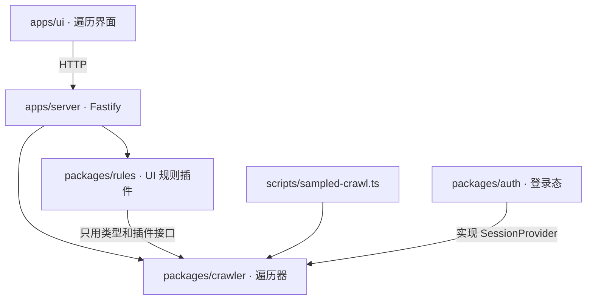

# 结构与插件契约

## 包及依赖方向



| 包 | 负责 |
| --- | --- |
| `@interaction/crawler` | 浏览器驱动与页面抓取、会话接口与 A/B 实验会话、抽象状态、控件类与列表抽样、动作选择与回退、跳转拦截、模型判断（JEV/LLM）与计费、输入分类、目标模式、运行存储（SQLite）、续跑、插件接口 |
| `@interaction/rules` | UI 规则（遮挡、裁切、文字截断、图片资源、图片比例、文字与背景同色）与跨状态跟踪；`rulesPlugin()` 把它们接成遍历插件 |
| `@interaction/auth` | 账号底座 `Auth`：加密保存会话快照、账号库（标签筛选）与占用锁、调度验证和巡检；`Auth.provider()` 是一个 `SessionProvider`。账号从哪来、什么算已登录由适配器 `AuthAdapter` 决定，自带参考实现 `PresetAdapter`（preset 文件 + 登录心跳） |
| `apps/server` | `/v1/crawls` 路由；按名字提供插件（`rules`、`sentinel`）和会话（目前是 `experiment`），每次运行由请求选择 |
| `apps/ui` | 发起/停止/续跑遍历，查看动作、状态截图、覆盖统计和插件结果 |
| `apps/test-site` | 本地演示站与规则夹具页 |

遍历器不导入规则包。是否检查、检查什么，由组装层（服务端、命令行脚本）决定。

## 遍历器

- **只测当前页**：主文档跳转用 Playwright 路由拦截并记录；同文档的 hash/history 变化记为低优先级。
- **抽象状态**：状态键由 URL、打开的弹层和可见控件类组成，数字被遮蔽，价格变动不产生新状态。
- **控件类与抽样**：同一组件结构的控件归为一类，每类只执行少数几个；列表按结构识别，只测前几项。
- **滚动查看**：每个新状态先把页面从顶部一屏一屏往下滚，再依次滚动页面里的每个滚动容器（列表、轮播、虚拟列表），每一屏读一次页面。只在滚动时才渲染的内容（懒加载区块、虚拟列表靠后的行）因此能被看到。滚完后页面和容器都滚回原位，再重新读页面：滚动出现的新控件成为候选，可以被点击；滚动让状态变了，就先宣布并检查新状态。弹层打开时只滚动弹层里（包括嵌套弹层里）的容器，不滚背后的页面。
- **列表抽样，不穷尽**：容器连续 2 屏只出现已经见过的控件种类（同一列表模板的成员、同一组选项、同一结构的输入框），就当作长列表，停止滚动，按列表抽样。页面按区块读到底，只有连续 2 屏都是同一列表的新成员时才停。一边滚动一边变长的页面或容器（信息流、无限列表）可滚动长度增长 2 次就认定为无限加载，停止滚动，同一页面之后不再滚它。每个页面最多 40 屏、每个容器最多 30 屏，只是防止异常的上限。
- **不重复滚动**：同一页面（同一弹层）之后的状态只看变了的部分。页面上没变的控件（按控件本身和尺寸比对，与位置无关）不再看；只滚到新出现或变化的控件所在的屏，每屏尽量覆盖多个。页面变长时（比如展开了一个答案），把底部看一次，底部出现了新内容才继续往下读。容器长度没变、第一屏以外也没有新种类的控件，就不再滚它。没再看的部分记为"和之前滚动检查时一样"。用 `sweep: false` 可以关闭滚动，只看第一屏（点击时仍会把目标滚到屏幕内）。
- **回退**：优先浏览器后退，否则直接重新加载入口页再重放到目标状态；没有效果的动作会从重放路径中剪掉。
- **模型**：程序信号弱时，先问 JEV（是否值得点、动作效果、输入类型），不确定时才用 LLM；调用次数和费用计入汇总。

## 插件接口

```ts
interface CrawlPlugin {
  id: string;
  onState(context: CrawlStateContext): Promise<PluginResult> | PluginResult;
  checks?(): CheckInfo[];
  reasons?(): Record<string, string>;
  onEnd?(): Promise<Finding[]> | Finding[];
}
type PluginResult = Finding[] | { findings: Finding[]; checks?: CheckSummary[] };
```

`onState` 在每个新状态上调用一次，插件不操作页面：`context` 提供状态键、序号、URL、遍历用的抓取、`page`、详细抓取 `detail()`（样式、布局、文字几何，在滚动前抓取）和运行记录 `runtime()`。同一插件、规则、元素和文本的问题每次运行只报一次；插件抛错记为 `plugin_error` 事件，不影响遍历。

`views()` 给出爬虫滚动这个状态时每一屏的详细抓取（页面往下的每一屏，以及每个滚动容器的每一屏），插件用它检查第一屏看不到的内容；`shoot(view)` 把页面滚回那一屏并截图。插件不自己滚动。

每次滚动记一条 `sweep` 事件，紧跟在状态之后：每个滚动面（页面或容器选择器）滚了几屏、怎么结束的（到底 `end`、无限加载 `endless`、达到上限 `budget`），以及滚动中新出现的控件数。

每个插件处理完一个新状态，记一条 `inspection` 事件，紧跟在该状态的 `state` 事件之后（因此不重复状态键）。事件里有：
- 总耗时，以及详细抓取的耗时；
- 插件返回的每项检查摘要 `CheckSummary`：结论、检查对象数、各结论的计数、耗时，以及没通过的原因码（按结论分组，每组取对象最多的 3 个，带对象数）；
- 本次运行里第一次用到的原因码的解释（来自插件的 `reasons()`），每个原因码在一次运行中只记一次；
- 本状态再次命中、但之前已报告过的问题（按问题在本次运行中的序号）。

摘要只存计数，不存每个对象的结果；问题本身仍以 `finding` 记录。`checks()` 在开始时记一条 `checks` 事件，给出每项检查的名称和说明，之后的摘要只带 id。调试页只读这些通用字段，不依赖具体插件。

`rulesPlugin(options)` 把每个状态的详细抓取组装成规则读的 `RulePage`，依次运行规则跟踪器，默认只上报 warning 和 error；每条规则的结论汇总成摘要。在当前状态上没有可检查对象的规则不写进摘要。

第一屏没法判断的控件（不在屏幕内：`VIEWPORT_RECHECK_PENDING`、`TEXT_SCROLL_RECHECK_PENDING`、`OUTSIDE_VIEWPORT` 等），以及滚动时才出现的控件，在爬虫滚动的第一屏完整显示它的画面里判断，用新的规则实例（不带跨状态历史，因为滚动后的画面不是下一个状态），结果替换第一屏的"无法判断"。没有滚动到的控件分两种：页面下方和之前滚动检查时一样（"已在之前的状态滚动检查过"），或在被抽样的长列表里（"按列表抽样"）。在滚动画面里发现的问题带上那一屏的截图（`target.shot`）。

## 会话接口

```ts
interface SessionProvider {
  id: string;
  resumeKey?: string;                         // 会改变页面内容的状态（实验分组）：续跑必须相同
  prepare(target: { url; viewport }): Promise<PreparedSession>;
}
interface PreparedSession {
  describe: Record<string, unknown>;          // 进事件和汇总，不放密钥
  context: SessionContextOptions;             // storageState、UA、语言、触摸……视口尺寸仍由遍历决定
  headers?: { domains; headers }[];           // 只对匹配域名加的请求头
  pinnedCookies?: Cookie[];                   // 整个运行期间保持该值
  initScripts?: string[];
  writes?: { cookies?; localStorage? };       // init 脚本写入的键名，供其他会话保存时排除
  check?(page): Promise<{ ok; reason?; facts? }>;
  recheckMs?: number;
  release({ context?, verified, foreign? }): Promise<void>;  // 必定调用一次；foreign 是其他会话写入的键
}
```

- **顺序**：浏览器启动前依次调用各提供者的 `prepare`；任何一个抛错，已准备的都会 `release`，运行失败且不启动浏览器。
- **合并**：`composeSessions` 把多个会话合成一个 context：存储合并；同名冲突报错（规则见 README）。
- **作用域**：按域名的请求头和钉住的 cookie 由驱动在一个 context 路由里改写请求。该路由最先注册，所以最后执行，看到的是最终发出的请求；遍历器自己的路由用 `fallback` 交给它。cookie 还会在响应 `Set-Cookie` 后重新写回 jar，并在页面里拦截 `document.cookie` / `cookieStore` 的写入，保证页面读到的也是钉住的值。
- **复查**：入口页加载后对每个会话立即 `check`，之后每个动作前按各自的 `recheckMs` 复查；任一失败记 `session` 事件并以 `session_invalid` 停止。汇总里的 `sessions` 列出每个提供者是否全部通过、检查了几次。
- **续跑**：`CrawlManager` 把所有 `resumeKey` 记在运行选项 `sessionKeys` 里，续跑时必须一致。

## 规则

每条规则读一次不可变的详细抓取，输出逐目标的 `pass`、`fail`、`unknown` 或 `not-applicable`。证据不完整（抓取被截断、字体未加载、布局不稳定等）时判为 `unknown`，不会当作通过。跟踪器按状态顺序接收抓取，跟踪同一控件跨状态的问题：恢复记为 resolved，控件被替换或文本改变时保留历史结果，不当作恢复。

产品要求（例如"这张图必须保持比例"）只能由宿主以精确绑定的 requirement 传入，页面上的属性或模型提议不会直接改变判定。

`sentinelPlugin()` 使用同一套 `RulePlugin` 和摘要接口提供语义检查。宿主的 `collect` 在每个冻结捕获上绑定对象、要求与已记录观察；没有绑定时仍为 unknown。体验审查通过 `unknown + warning` 输出意见，不自动形成 fail。静态 DOM 检查可声明 `sweepTargets: 'dom'`，在没有可点击控件的滚动画面里仍能运行。逐项对照及实现边界见 [SENTINEL-PLUGINS.md](SENTINEL-PLUGINS.md)。
