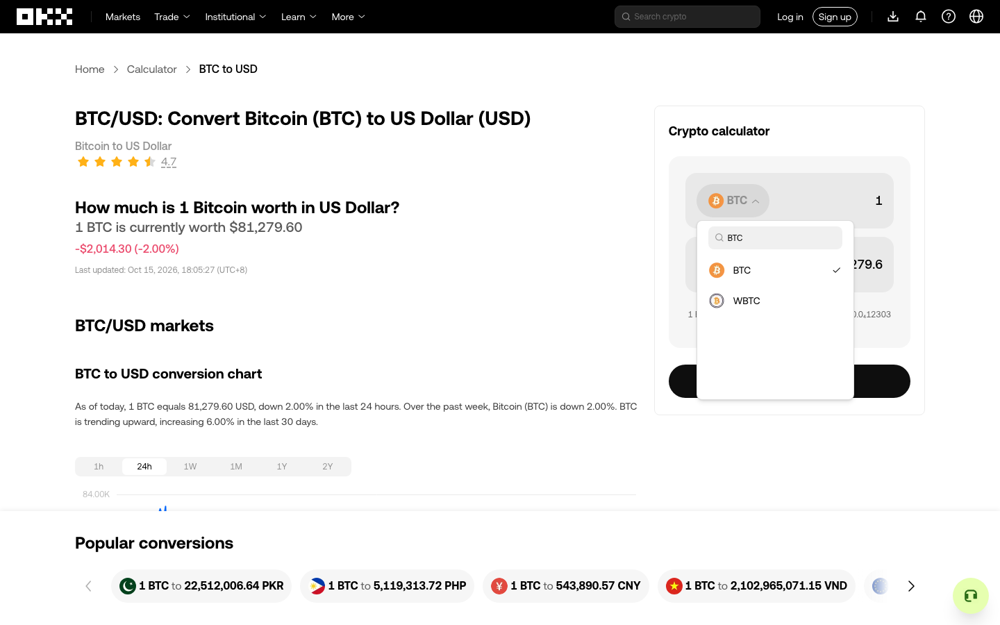
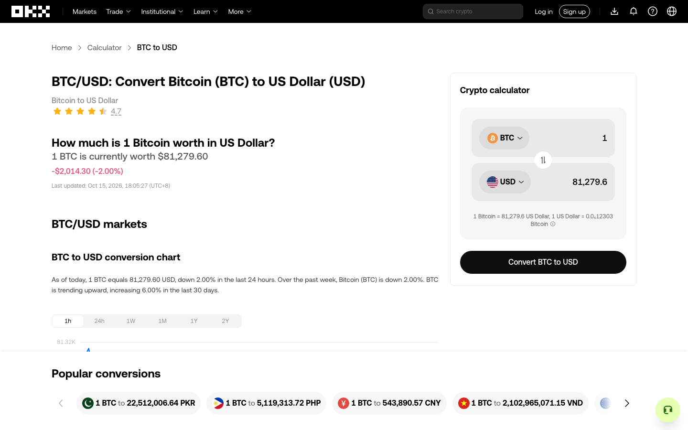

# 无选择退出与原样本继续验收

通用弹层退出审阅已实现，真实 OKX 新会话完成了“打开 BTC 列表 → 搜索 BTC → 不选择币种退出 → DFS 继续原先批准的 1h 样本”。退出结果分别验证关闭、父页面就绪和指定字段保留；本轮没有选币或导航，仍不构成整页穷尽。

分支为 `codex/region-incremental-review`。先以 `8abcb97` 合并 main 的动态页面修复 `8284bf9`，再实现通用退出审阅 `2f89818`，最后在 `ebc15f6` 补齐指针移出后已关闭面板的验证。没有加入 OKX 专用执行规则。协议见[上层审阅的弹层退出](../../BOUNDARY-EXITS.md)。

## 两次冻结源码实测

2026-10-15，两次均使用全新独立 Chromium 会话打开公开 [BTC/USD 转换页](https://www.okx.com/convert/btc-to-usd)，经通用 workbench 调用引擎；未直接操作 DOM。各会话内源码不变，起止源码哈希一致，结束后关闭会话。预算为 30 次动作、30 分钟、深度 40，显式启用区域审阅。

独立上层 agent 根据当前截图和引擎材料审阅区域、BTC 入口用途、样本及退出位置。图表与换算器各确认 6 个控件；图表在重叠的相似列表组和区域组中均只批准 `1h`，换算器只批准 BTC 入口。先显式打开入口和搜索，保留图表样本等待退出后自动执行。Search 使用已支持的原生输入能力；退出位置没有继承入口用途批准。

| 会话 | 实际动作与结果 | 最终状态 |
| --- | --- | --- |
| run-08，`5c475cdc-198e-480e-80bf-4be38f8ebdd7`，源码 `2f89818` | Close、BTC、Search=BTC 成功；外部退出执行期间目标/边界再次校验失败。动作后观察虽已无面板，但完整退出结果仍为 `unverified` | 4 次动作，`BOUNDARY_EXIT_UNVERIFIED`；再次 explore 未继续派发；没有执行 1h |
| run-09，`3981b3c2-02e0-4cee-9928-99173a57c4d5`，源码 `ebc15f6` | Close、BTC、Search=BTC、外部退出、1h，共 5 次动作均成功。退出记录 `inputPhase=pointer-move`、`closedAfterMove=true`，省略点击 | 关闭、父页面就绪、保留字段均通过，结果 `verified`；DFS 执行原 1h 样本，随后 `REGION_REVIEW_REQUIRED` |

run-08 没有细分输入阶段，不能仅凭最终面板消失认定其关闭原因；指针移出关闭只是当时的推断，旧失败证据未被改写。run-09 记录移动阶段后现场验证和完整结果观察，证明可在省略点击的情况下完成此次退出，不推断网站内部事件处理器的因果。

上层批准的退出位置是面板外 “Crypto calculator” 标题的一个当前命中点，限定一次尝试；指定保留 `1h`、`24h` 和两个金额框共 4 个控件。搜索框及选项预期隐藏，不作为保留字段。退出位置批准没有授予历史重放权限。

run-09 退出后仍为原 URL、原文档和 BTC/USD；两个金额值在此会话各阶段保持 `1` / `81,279.6`。图表原组 ID、决定内容及区域审阅来源均保留，组 revision 可随新观察累积。退出后的 `1h` 由 `purpose=exploration` 的 DFS 动作执行，最终 `1h` 选中、`24h` 未选中，没有通过手工点击代替恢复后的探索。





## 回归与证据

- 新增 20 项退出回归，覆盖 hook、HTTP、调试页、嵌套边界、过期实例、保留字段变化、未知结果、自动恢复停止、重复批准及移动后关闭等情况。
- [相关回归](related-regression.log)：4 文件 / 52 项通过。
- [最终全量回归](regression.log)：76 文件 / 570 项通过，源码为 `ebc15f6`。
- `pnpm typecheck`、`pnpm build`、`pnpm smoke:built` 均通过，见[构建产物烟雾记录](build-smoke.json)。
- [证据摘录](okx-acceptance.json)包含两个会话的动作前后观察、退出审阅/结果、原图表决定、命令、持久事件、独立上层决策与最终复核，以及源码和原始文件哈希。

完整原始材料保留在忽略目录 `work/exhaustion-goal/run-08`、`run-09`。离线核查：

```sh
python3 docs/experiments/boundary-dismissal-2026-10-15/verify-okx.py
# 本地保留原始目录时，再核对文件哈希：
python3 docs/experiments/boundary-dismissal-2026-10-15/verify-okx.py --raw-root work/exhaustion-goal
```

## 仍开放

本轮仅验证无选择退出与原已批准样本继续。最终还有 199 个控件未划分区域、页面滚动未分配、换算器区域因结构变化失效、其余组待决，以及 Canvas、结构发现与身份缺口。完成审计仍为 `blocked / exhaustive=false`。这批待决范围需要上层继续确认，不能算作退出功能失败，也不能算作已覆盖。

下一步实测可用已有局部补审补齐变化后的换算器，并按目标逐批扩大已批准区域与样本。区域内成员级判断复用、复杂抽样、任意坐标或复杂取消手势、iframe/Shadow DOM、未声明服务端状态恢复仍未实现。`verified` 不表示完整检查点或后台业务环境恢复。

后续已在新会话完成换算器补审、金额/FAQ 样本和独立页面遍历，并修复从中部开始滚动时的反向遗漏，见[扩围与滚动修复验收](../scope-traversal-2026-10-15/README.md)。这些新证据不改变本页两次历史会话的完成范围。
