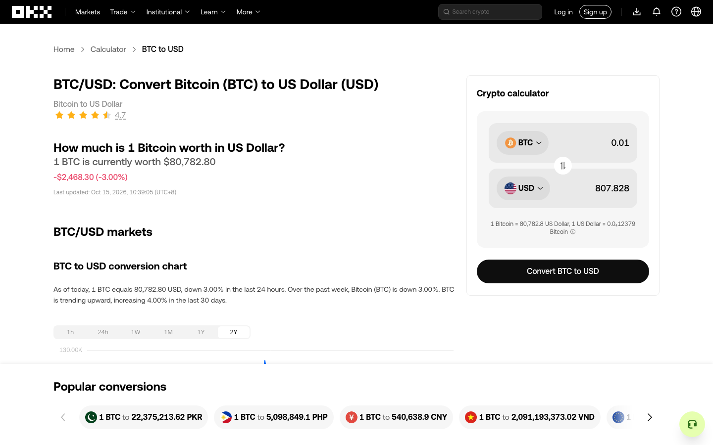
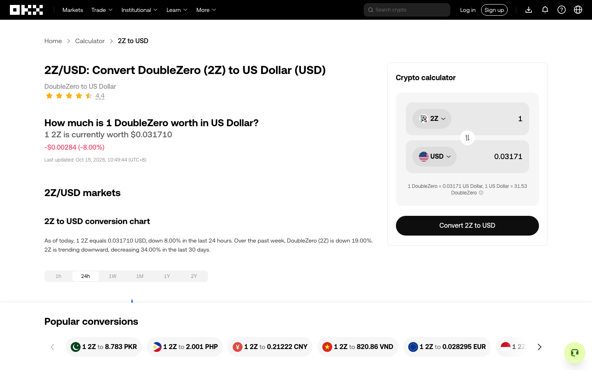

# OKX 通用探索范围的目标驱动验收

2026-10-15，以公开 BTC/USD 转换器为业务目标，验证上层是否可以控制探索深度，并准确保留未测范围。引擎基线为 `431a587`；第二次会话包含本次跨文档退出待办修复。两个会话独立，不合并动作数或覆盖率。

## 目标与配置

测试金额样本、图表时间范围和币种菜单。全站导航、登录、兑换交易、全部币种和 Canvas 内部均不在目标内。地区提示只关闭，没有登录、提交订单或改变访问环境。

使用通用工作台 `scripts/exploration-workbench.ts`，本次增加可选第三个参数 `OPTIONS_JSON` 和只读 `/report`，使目标配置与代码分离。配置启用 `decisionScopes: ['region', 'branch', 'input-space']`，列表保持默认 review；预算为 80 次动作、深度 30、30 分钟、1 GiB 持久证据。两个会话均未触及预算。页面操作均由 BrowserEngine 实际执行；独立 agent-browser 仅观察了页面，不计入执行证据。

外部判断按当前观察提交：BTC 入口用途、源金额样本、菜单外点击退出声明，以及相似列表选项的共同用途。没有向引擎加入 OKX URL、币种或 DOM 特例。范围决定和用途审阅分别保存，每次操作仍校验当前节点。

## 首轮结果与发现

会话 `2f3c6d18-9bc2-40b9-b630-e194e355fe2b`，[证据摘录](before-fix.json)。

| 验收项 | 实际结果 |
| --- | --- |
| 未答复时先处理其他工作 | 根区域仅选择 6 个图表操作，5 个 branch 选 all，2Y 保留待决。5 个范围依次执行后以 EXPLORATION_DECISION_REQUIRED 暂停 |
| 暂缓与恢复 | 2Y 改 defer 后以 EXPLORATION_DEFERRED 暂停；再改 all 后实际执行。6 个动作的后态分别确认对应 tab 被选中 |
| 决定本身不执行 | 待决 → defer → all 的三个决策快照动作计数均为 6；实际 resume 后才变为 7 |
| 输入样本 | 上层提供 0.01、1、100；当时值为 1，生成两个不同值候选。只执行 0.01，USD 显示 807.828；100 留作 deferred / not_attempted。两个同名字段的身份未合并 |
| 本轮不测 | Main menu 等范围选 skip，Trade 等可执行操作保持 skipped / not_attempted。原有风险/导航阻塞仍保留，不因 skip 被改写为成功 |
| 范围重叠 | listbox 区域选 all，similar-list 选 defer，选项继续暂缓。all 没有解除其他范围约束 |
| 列表恢复 | 审阅退出方式后实际关闭菜单；改为仅选 2Z 后，引擎执行 BTC 入口恢复并选择 2Z。其余 5 个首屏选项未选择，未滚动穷尽 |
| 条件失效 | 2Z 导航改变文档、URL；旧通用范围和列表用途审阅失效。返回 BTC 也没有复活旧通用批准 |

首轮共 16 次动作记录为 succeeded，但不能等同于 16 个业务检查通过：Escape 成功派发后菜单仍在，引擎正确停在 ACTIVE_BOUNDARY_BLOCKED；补充源金额框点击的退出声明后，才实际验证边界消失。

本轮原计划中的搜索输入未执行：在菜单选择、范围重叠、暂缓恢复和导航失效已得到证据后，搜索保持 skip。搜索功能不能计作本轮通过，也未复用以往实验结论。



进一步追查发现了程序缺陷：菜单重新进入后产生了一个新的、尚未使用的审阅退出待办。选择 2Z 使文档改变，但旧规则只在同文档确认菜单关闭时退役退出待办。调度器因此执行历史返回 BTC，试图补做旧退出，最终产生一次 UNREACHABLE，原因是检查点路径缺少重放许可且 observable-state 未通过。这次返回并非测试目标所需；不能把它当作恢复能力成功的证明。

## 修复与真实复验

controls 模式在完整观察确认文档实例改变后，将尚未尝试的旧边界退出意图标为 `superseded / boundary_document_changed`。已尝试记录保留；新文档同名/同键边界的当前退出照常发现；不宣称旧状态恢复，也不豁免当前目标、安全和范围检查。

新增两个回归用例，分别覆盖导航后没有边界、导航后存在相同边界键的情况。修复前两者都失败，旧退出仍为 pending；修复后均通过，并确认不会发生额外返回或恢复，也不把退役记为覆盖。

修复后的独立会话 `5911bc0a-b52d-4e83-b123-8240ee36801b`，[证据摘录](after-fix.json)，重复菜单“暂缓 → 退出 → 指定 2Z → 自动重入 → 选择”路径：

- 共 7 次动作：关闭初始提示、打开 BTC、尝试 Escape、审阅出口点击、恢复 BTC 入口、选择 2Z、关闭新页面提示。
- 旧退出待办退役且保持 not_attempted；历史返回为 0，检查点恢复为 0。
- 停留 `/convert/2z-to-usd`，以 EXPLORATION_DECISION_REQUIRED 等待新范围判断；旧通用决定与用途审阅没有被跨文档复用。
- 首次尝试关闭提示时，页面迟到变化触发 STALE_OBSERVATION，未派发旧动作；读取更新后的观察再执行成功。这是已有保护生效，不计作一次浏览器操作。



7 与 16 不能直接比较总效率：第二次没有重复 6 个图表操作和 1 次金额输入。可比结论是菜单导航路径不再额外返回 BTC，也不再为旧退出生成一次失败恢复。

## 证据与边界

JSON 从各阶段的引擎报告和关闭后的 SQLite 记录抽取，包含会话/观察/尝试/组版本、决策、选中状态、字段值、退出待办、恢复结果及相关事件；记录数据库和 core 引擎文件的 SHA-256。事件从完整 SQLite 账本读取，未使用只返回前 1,000 条的临时调试查询作为完整事件证明。原始本地证据保存在 `work/real-page-scope-decisions` 与 `work/real-page-scope-decisions-fixed`，均为隔离浏览器会话，现已关闭。

可离线核对提交的证据：

```sh
python3 docs/experiments/exploration-decisions-2026-10-15/verify.py
```

该命令核查历史摘录，不重新访问网站。实际执行验证了 all/sample/defer/skip 的调度语义；通用 hook 的失败、超时、迟到决定、任意自定义范围等继续由独立回归覆盖。

本轮验证：49 个文件 / 288 项测试通过（303.23 秒），typecheck、build、smoke:built 和上述证据核查均通过。测试产生的通用演示截图与冒烟记录已还原，提交仅包含本次功能修复、回归和实测材料。

尚未完成的能力已回写 ROADMAP：无语义业务区域的自动发现、避免逐链接决策负担、未知退出方式的可靠材料、业务条件接入、边界输入与组合、跨文档判断复用，以及列表之外的用途审阅复用。整页与全列表穷尽、Canvas 业务结果、跨文档完整状态恢复均未证明。
