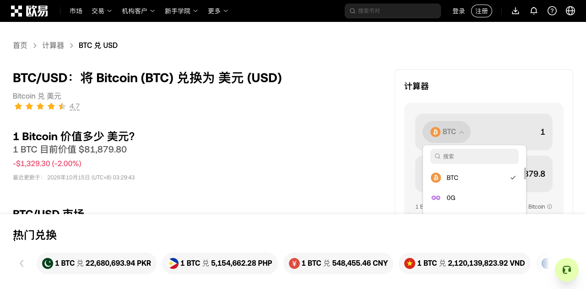

# OKX BTC/USD 真实页面测试

## 后续复验：通用调度与复合弹层修复

`codex/okx-exploration` 在原始审计之后继续实测，使用通用审阅工作台与独立审阅数据；没有 URL、币种或站点 DOM 特例。动作上限 10,000、深度 100、24 小时，证据容量 20 GiB。以下是阶段性结果，原始审计与其统计保留在后文，不合并为一次运行。

- 新出现控件优先执行、共享同状态/上下文的失败恢复、退役已关闭弹层的合成退出动作，以及正确命名无名控件，均有独立 HTML 回归。
- 外部操作审核让两个币种入口进入真实引擎候选，原始 DOM 的 actions 仍为空；审核没有冒充原生能力证据。两个数值框输入 2 和 100 后实际联动，分别得到 USD 163,631.6 和 BTC 0.0012222578035049464（仅为当次页面结果）。
- 第一次审核运行打开 USD 下拉后，搜索框因边界只包含内部 listbox 而被阻止；Escape 没有关闭下拉。修复通用复合面板识别后，在真实页面先输入无匹配值，再搜索 USD 均成功；边界在空结果时保留，搜索框持续可用。搜索 ETH 也发现了匹配选项。
- 选择已选中的 USD 实际触发同 URL 的文档重载，两个金额框回到页面初始值。这里只确认选项选择和回到计算器，不宣称恢复了旧金额。随后以历史和当前截图中的相邻币种及字段用途分别确认两个金额框身份；两个同名字段没有合并。
- 第一阶段 189 项测试 / 37 文件通过，typecheck、build、smoke:built 通过。此后继续补齐容器滚动，结果见下文；其他币种分支、无效 Escape 的替代退出、非模态重入及离页链接仍未完成验收。

阶段证据见 [reviewed-progress.json](reviewed-progress.json)，搜索截图见 [reviewed-search.png](reviewed-search.png)。人工判断作为有来源的数据记录，不能视为通用自动识别已经完成。仍不能宣称整个页面穷尽。

### 容器滚动与币种往返

通过引擎继续搜索并选择 ETH，实际进入 `/convert/eth-to-usd`，再通过其选择器搜索并选择 BTC，返回原页面。两次导航及完整观察均 succeeded，未执行兑换；这是页面往返，不是旧金额检查点的严格恢复。

通用适配器新增 CSSOM 滚动容器发现、当前节点定位/遮挡检查、滚动效果确认、偏移采样与失效旧意图处理。独立虚拟列表使用默认探索，滚动发现并实际填写全部 8 个输入框，返回顶部后退出，没有历史滚动恢复；横向滚动、外部位置变化和遮挡反例也通过。完整验证为 192 项测试 / 38 文件，以及 typecheck、build、smoke:built。

真实页面另起会话使用相同大预算。外部运行器逐次选择引擎生成的滚动候选，先向下到实测底部、再向上到顶部；60 次操作全部 succeeded，页面 scrollY 始终为 0，发现 107 个法币选项。列表总高度随虚拟行测量从估算值收敛，操作始终依据当次观察的范围；返回时未发现额外选项。此运行验证滚动遍历能力，默认调度由独立列表回归验证；不将 107 个“已发现”选项报成“已选择”。

完整滚动账本见 [container-scroll-results.json](container-scroll-results.json)，并留存[底部截图](container-scroll-bottom.png)和[返回顶部截图](container-scroll-top.png)。页面仍有未完成分支，不据此关闭整体目标。

### 自动遍历继续后的阻塞分类

同一会话在上述滚动之后继续默认探索，累计 99 次动作（包含前面的 60 次容器滚动），没有检查点恢复尝试。两次切换 Trade → Spot → Crypto 后，稳定性采样与详细证据采集之间发生变化，动作记为 unknown 并暂停；第一次补做观察后稳定，继续探索又遇到相同采集窗口问题。预算没有耗尽。记录见 [automatic-followup.json](automatic-followup.json)。历史 unknown 动作仍保留 unknown，后来的完整观察不追认过去的成功。

此时 372 条 blocked 待办中，240 条为离页导航待审核，128 条为用途/风险待审核，4 条因当前观察不完整。它们是累计待办记录数，包含重建实例，不能解释为 372 个独立程序缺陷，也不能拿累计控件数计算转换器业务完成率。

- **程序修复**：采集窗口变化应先在原观察预算内重新采样和取证，不重复执行动作；持续变化仍保留不完整状态。当前分支补充了这一处理。菜单范围重入、跨状态身份连续性及恢复规划仍是程序待办。
- **外部语义判断**：自定义控件用途、有效输入样本、离页分支范围、歧义身份及操作可逆性需要分别记录证据。一个判断不能替代其他判断；确认两个历史节点属于同一金额字段，不等于允许重放或证明旧金额已恢复。
- **账号与环境条件**：登录、验证码、真实交易授权及服务端重置能力不由身份裁决解决。当前未登录实验不能据此宣称覆盖这些业务。

当前零恢复失败只说明这一阶段尚未尝试检查点恢复，不能宣称返回路径问题已经全部修复。

修复后另开会话复验 Trade → Spot → Crypto：第一次 Crypto 点击在详细采集时遇到变化，记录 `EVIDENCE_CAPTURE_RETRIED` 一次，重新采样后稳定，动作 succeeded；随后 USDT → Crypto 也成功。选择动作的是外部运行器，没有把该定向复验冒充默认探索。独立回归同时覆盖短暂变化恢复、持续变化超时和原动作只执行一次。

本阶段完整验证：195 项测试 / 38 文件、typecheck、build、smoke:built 全部通过。

同一新会话还依据截图和原生按钮证据审核了两个金额框之间的换向按钮，完成 BTC/USD → USD/BTC → BTC/USD。两次均重载文档，返回的是原币对页面，未验证旧金额恢复；没有操作独立的兑换/购买链接。页面重载后重新审核新按钮，未将旧实例判断直接继承给新文档。结果及判断来源见 [capture-retry-results.json](capture-retry-results.json)。

### 带来源的退出声明与自动返回

上述新会话随后继续默认探索，累计 67 次动作（包含 10 次外部定向验证动作），以 `known_frontier_exhausted_with_gaps` 结束；没有再次因观察不完整或预算耗尽暂停。9 次检查点恢复均因路径缺少重放权限而不可达，118 条遗留任务关联这些恢复结果。菜单分支和文档重载前的任务仍未覆盖，不以此结束页面穷尽目标。账本见 [capture-run-automatic.json](capture-run-automatic.json)。

当前分支补充通用 `declared-boundary-exit/v1` 契约：外部判断指定当前观察、具体控件和最内层弹层，并提供退出用途的依据。退出仍受节点、遮挡、提交风险和完整观察检查；声明不改写原始 DOM，也不赋予历史重放资格。

真实下拉验证发现，点击已展开的 USD 入口没有关闭菜单；它的 succeeded 仅代表点击完成，弹层仍被保留。随后审阅并点击弹层外的 BTC 金额框，列表消失，文档和金额均未变。再次执行“打开 → 无结果搜索 → 清空搜索 → 外部点击关闭”，严格验证原检查点为 `REACHED_VERIFIED`。这条路径不需要选择当前币种触发重载。证据见 [reviewed-exit-results.json](reviewed-exit-results.json)、[打开截图](reviewed-exit-open.png)和[关闭截图](reviewed-exit-closed.png)。

进一步在新会话中保持弹层打开，仅提交带来源的退出声明，然后直接调用 reachCheckpoint：引擎先尝试 Escape，观察到弹层仍存在，再选择审阅后的外部点击，自动返回原检查点，结果 `REACHED_VERIFIED / Verified after boundary exit attempt`。此时金额框历史身份仍有歧义，但当前实例定位成立；退出动作保持不可历史重放。完整记录见 [automatic-boundary-return.json](automatic-boundary-return.json)。这是特定已审阅弹层的自动返回验收，不代表其他非模态菜单和跨文档恢复已完成。

该会话还依次操作 1h、1W、1M、1Y、2Y、24h 六个已有时间范围候选，均成功且各自成为唯一选中的 tab；Canvas 图表内部及行情正确性未据此验证。见 [chart-range-actions.json](chart-range-actions.json)。随后根据原始及当前截图的相邻币种，将两个 placeholder 同为 0 的金额框分别确认为独立控件，保留不同身份，见 [distinct-amount-identities.json](distinct-amount-identities.json)。对数值输入的重放许可另外记录，不由身份裁决隐式授予；没有声明两个联动金额可各自独立恢复。默认探索继续运行。

退出声明的独立回归覆盖实际关闭、无效点击、过期/错误对象声明、遮挡、原生提交风险和自动检查点返回。本阶段完整测试为 200 项 / 39 文件，typecheck、build、smoke:built 通过。

### 子面板内容不应改变父控件身份

继续检查同一自动运行时，发现 Open Spot sub-menu、USDT 和 Crypto 三个物理节点分别累积 9、7、7 个逻辑身份。它们的角色、名称和区域并未改变，变化来自 stableKey 中父列表项的文字：采集器把浮动子面板的标签、行情、加载及搜索结果都包含在父记录描述中。因此重复身份属于程序缺陷，不应交给人工逐个合并。

通用修复从父列表项的描述中排除嵌套列表和独立面板内容。没有语义标记的浮动面板还需具备同项展开入口、独立定位、超出父项范围等结构依据；普通定位标签仍保留。完整观察及父子业务绑定不变，没有站点 URL、类名、币种或标签特例。

新会话以引擎真实操作关闭提示、打开 Trade 和 Spot，反复切换 Crypto／USDT，再搜索无匹配值并清空，共 9 次动作全部 succeeded。三个控件在 10 次记录观察中各保持一个身份，无需 resolveIdentity 或针对它们提交操作审核。此前的 9／7／7 是旧自动运行的采样结果，两段运行轨迹不同，不作为覆盖率或性能的严格对照。原始身份键、观察引用和动作账本见 [stable-menu-identities.json](stable-menu-identities.json)。

独立回归另验证：子面板变化不重复生成父入口任务；父记录 A 变为 B 时，即使 DOM 节点相同也须改变身份；嵌套子记录变化不会改动父身份，但子记录保留父绑定；普通定位标签仍参与业务识别。完整测试 203 项 / 39 文件、typecheck、build、smoke:built 通过。

这一阶段解决同文档身份漂移，未证明菜单关闭后的自动重入或跨文档恢复已完成。自动探索继续，已发现选项也仍须与实际选择过的选项分别报告。

### 同文档非模态菜单重入

前两轮自动探索现已结束：退出声明版本累计 109 次动作（8 次外部动作、98 次默认探索、3 次恢复），身份修复版本累计 92 次（9 次外部动作、82 次默认探索、1 次恢复），均为 `known_frontier_exhausted_with_gaps`。前者 529 条 blocked，后者 497 条，分别包含 80／61 条路径缺少重放许可的遗留任务；其余为导航审核、用途审核和遮挡。它们的定向准备步骤不同，不能据此声称修复提升了某个覆盖率。均未耗尽预算，见 [pre-reentry-automatic-results.json](pre-reentry-automatic-results.json)。

现有范围重入只覆盖已识别弹层，普通菜单关闭后仍会进入严格检查点恢复。此次增加通用的目标显现关系：在同文档、同业务上下文及同探索范围内，利用成功可重放的界面入口与目标出现前后的观察，逐级重新进入。原始动作执行前后之外，还允许使用下一次操作之前的连续只读观察，解决异步加载后才发现子控件的情况；记录的是观察区间关系，不冒充因果证明。

真实定向验证先关闭地区提示、打开 Trade 和 Spot，并额外观察到异步加载出的标签；随后点击图表 1h，使菜单和标签消失。外部策略仅选择尚未完成的 Crypto 标签待办，引擎自行规划并执行 Trade、Spot 两次恢复操作，再实际点击 Crypto。最终标签唯一选中、图表仍为 1h、文档未变，7 次动作全部 succeeded；没有检查点恢复调用，也没有页面刷新。入口及其观察来源见 [nonmodal-reentry-results.json](nonmodal-reentry-results.json)，结果截图见 [nonmodal-reentry.png](nonmodal-reentry.png)。这是一条由引擎规划返回路径的定向验证，不能当作整页默认遍历已完成。

独立回归涵盖两级入口、子控件操作后菜单自行关闭、延迟加载、无效入口的有界尝试、当前排除/重放许可、业务上下文改变、文档替换，以及不能跨其他操作借用延迟出现的目标；人工裁决已可见控件的身份也不当作显现关系。完整验证为 212 项 / 40 文件、typecheck、build、smoke:built 通过。最新版本另起大预算默认遍历，站点语义继续通过独立带来源的审阅记录提供；跨文档恢复、未审核导航和剩余选择分支继续待办。

## 原生历史返回与当前关闭控件

跨文档返回补充通用原生历史路径：只使用同一浏览器会话中已观察且仍存在的 GET 条目，按条目 ID 返回，不根据币种、URL 规则或页面选择器生成路线。操作前核对当前历史位置，返回后重新观察；POST 结果、未处理业务副作用、活动弹层、过期历史与显式排除仍会阻止返回。独立回归覆盖向后/向前、相同 URL 的不同条目、外部历史变化、浏览器重建，以及页面状态改变后不能宣称旧检查点恢复。

第一次真实选币验证停在 ETH 页地区提示：当前 Close 唯一可定位且已被原始观察认定为退出控件，但历史身份歧义令恢复规划不使用它。修复后允许当前受支持的退出实例参与恢复，仍保持不可历史重放，并验证实际关闭；无效退出、遮挡和表单提交保护继续保留。没有为这两个地区提示额外提供人工退出声明或身份合并。

新会话中，外部审阅仅指定 BTC 选择器及搜索出的 ETH 选项。引擎随后自行完成三步恢复：关闭 ETH 地区提示 → 原生历史返回 BTC 条目 → 关闭返回后新出现的地区提示。三次动作全部 succeeded，准确回到原生条目 4，活动弹层为零；含准备步骤累计 7 次动作。记录见 [native-history-return.json](native-history-return.json)，截图见 [native-history-return.png](native-history-return.png)。这是引擎规划的真实返回验证，不是默认整页遍历结果。

同一次严格检查点仍为 `UNREACHABLE`：两个金额值相同，但完整观察中的转换链接顺序和列表滚动信息等发生变化，`observable-state` 没有通过；后续原路径也缺少重放权限。返回页面成功与旧状态验证失败分别保留，没有放宽比较规则。再依据前后截图的相邻币种，将两个金额框分别关联到各自原身份，未把同名字段合并；数值样本和重放许可另外审核，未声明联动字段可以独立恢复。此后继续默认探索。

通用原生返回与当前退出实例的定向回归共 16 项通过；完整验证为 223 项 / 41 文件、typecheck、build、smoke:built 通过。更长的币种列表遍历仍在独立会话运行，预算没有耗尽；跨文档身份自动识别、未审核导航和全部选择分支仍未完成。

## 继续发现、审阅分支与退出去重

较早启动的默认遍历已将完整币种列表滚动到实际底部：当次 `y = maxY = 35920`，末端为 ZKP、ZM、ZORA、ZRO、ZRX；历次观察累计记录 823 个不同的选项名称。底部证据与首次观察引用见 [crypto-list-bottom.json](crypto-list-bottom.json)，[截图](crypto-list-bottom.png)保留当次真实画面。这些选项尚未逐个选择，不能算 823 个业务分支已覆盖。该长会话启动于最终非模态身份裁决保护及原生历史返回修复之前，不能把它归为最新代码的完整验收。

在 `722c9b1` 的独立会话中，进一步审核并实际打开下载信息菜单、帮助菜单，均出现相应内容；轮播 Next / Previous 将水平偏移从 0 改为 896，再回到 0。未下载或安装应用，也未发送客服消息。另逐项审阅普通原生链接，实际访问 USD→BTC、BTC→PKR、BTC→PHP 三个计算器页面，再由引擎关闭提示并通过历史返回。每条均确认目标 URL、完整观察和返回后的无弹层页面；旧检查点仍为 `UNREACHABLE`，未把页面往返混同于字段和完整布局恢复。记录见 [reviewed-page-branches.json](reviewed-page-branches.json)，菜单截图见[下载信息](download-menu.png)和[帮助菜单](help-menu.png)。这属于带来源外部选择的定向测试，后续更多公开转换链接继续执行中。

退出声明同时暴露了一个通用去重缺口：声明需要每次绑定新观察，其 observationId 变化进入抽样 key，导致同一个无效退出点击被当成新候选。在独立页面上，严格恢复和默认探索都重复点击 7 次，耗尽 8 次动作预算（另一次是打开面板），没有尝试其他出口。修复将退出尝试按当前范围、节点实例、操作和值识别，不以审阅引用更新视为新路线。现在同一无效点击与 Escape 各试一次，确认仍未退出后暂停，并继续阻止背景操作；发生其他交互后允许重新尝试，避免把已改变条件的出口永久封死。此修复没有改变站点规则或放宽状态验证。

定向回归已覆盖无效退出的严格恢复、默认遍历去重、条件改变后的重试，以及原有退出/历史返回约束；完整验证为 226 项 / 41 文件、typecheck、build、smoke:built 通过。长列表会话随后进入法币菜单，在默认搜索无结果及 Escape 无效时暂停；补充当前法币搜索框的清空样本和当前弹层的外部点击退出声明后，已恢复滚动。审阅继续绑定实际实例和当前边界，没有修改页面 DOM 或让旧实例审阅跨文档继承。

## 原始审计

2026-10-15（Asia/Shanghai），测试版本为已合入 `main` 的 `e793fba`。先完成合并，再访问 https://www.okx.com/convert/btc-to-usd 。合并验证：181 项测试 / 34 个文件通过，typecheck、build、smoke:built 通过。运行环境为 Node.js 24.21.0、Playwright Chromium，1440 × 900。

## 范围与方法

使用新建、未登录的浏览器上下文，不导入账号状态。页面出现地区服务限制提示，关闭提示后公开计算器可访问；未尝试注册、登录或实际兑换。引擎访问英文原 URL；独立 agent-browser 观察被站点导向简体中文 URL（[入口截图](initial.png)）。两者的运行证据分别保存，不混作同一会话。

- 自动探索：使用 BrowserEngine 的默认 `controls` 策略和默认排序；预算 10,000 次动作、100 层、30 分钟。完整观察证据持久化，未声明可逆字段、重放白名单或环境重置。
- 运行器通过 actions hook 明确排除离页链接，以及风险不是 interface 的动作。保留这些候选及排除原因，不把排除记为已覆盖。此限制属于本次实测范围，不是引擎对网站的特例。
- 手动引擎验证：关闭地区提示，输入 BTC=2，建立检查点；输入 USD=100，调用 reachCheckpoint；随后手动恢复 BTC=2，再次验证相同检查点。
- 独立浏览器核对：实际点击币种选择器，搜索 ETH 并选择，确认页面进入 `/convert/eth-to-usd`。该结果只证明漏识别的控件真实可用，不计入引擎覆盖率。

## 已确认的问题

自动探索约 9 分 13 秒后暂停，恢复运行没有新增动作。最终结果见 [summary.json](summary.json)：

| 指标 | 本次结果 |
| --- | --- |
| 实际动作 | 46：45 succeeded，1 unknown |
| 已覆盖的遇到控件 | 30；全部观察累计 513 个可操作控件身份/实例，另有 63 个未确认元素 |
| 失败恢复 | 68：67 次路径不允许重放，1 次重放目标不唯一或缺失 |
| 待办记录 | 45 executed、28 superseded、463 blocked、20 pending、1 unknown |
| blocked 的组成 | 346 离页链接排除、19 用途未审核排除、68 恢复失败、30 遮挡 |
| 停止原因 | OBSERVATION_INCOMPLETE，截图/详细证据因 EVIDENCE_BUDGET_EXHAUSTED 无法完整保存 |
| 证据与预算 | 118 次观察；500,000,000 字节持久证据预算耗尽；动作、深度和时长预算没有耗尽 |

这些数字分别描述动作、控件和待办，不能相互替代。累计控件数包含全站导航、页脚、展开菜单，以及最后重开入口后出现的新实例和新内容；不能把 30/513 当作转换器业务流程的完成率。只完成了动作的控件也不代表业务断言通过。

### 可操作与可恢复之间仍有缺口

两个计算器输入框均使用 placeholder `0`。引擎保留历史身份歧义，按当前节点实例准确执行输入：BTC 从 1 改为 2 时，USD 从 81,879.8 联动到 163,759.6；随后 USD=100，BTC 联动到 0.001221302445780278。这些是当次页面结果，不代表当前行情。

在 BTC=2 时建立的同一个检查点，第一次自动返回为 `UNREACHABLE`，原因是 `Checkpoint path contains actions without replay permission`。诊断中的 dirtyActions 为空，不能把这次阻塞解释成未知业务副作用。路径中的入口提示关闭和同名输入均按当前节点实例执行，不具备历史重放资格；本次也没有可逆声明供自动恢复使用。该结果定位到路径约束，不能断言只有一个动作是唯一根因。

手动把 BTC 恢复为 2 后，再调用同一检查点，得到 `REACHED_VERIFIED`；完整 observable-state 和留存证据检查均通过。因此页面本身能恢复，缺的是自动恢复路径的依据和执行机制。不能靠调大预算解决，也不应放宽检查点验证来掩盖缺口。原始动作、数值变化和两次恢复结果见 [recovery-evidence.json](recovery-evidence.json)。

### 币种选择器未进入可执行候选

BTC 和 USD 选择器可见、有 pointer 样式，命中测试通过，但 DOM 未提供本引擎当前支持的按钮/展开语义或直接处理器证据。观察中两者 actions 为空，归为未确认元素。独立浏览器可以展开、搜索、选币，证明这是发现能力的缺口。

应增加有证据的主动探测和外部判断机制；单凭 cursor:pointer 不能把任意布局容器升级为确定可操作控件。

### “动作成功”仍需要与“有效测试”区分

默认采样尝试把两个数值用途的文本输入框填为 `example`。浏览器填入动作记录为成功，但页面过滤输入后仍保留原数值 1 和 81,879.8，不能算作有效的数值换算验证（[前后值记录](input-samples.json)）。手动输入 2 和 100 的联动检查才验证了本次计算器流程。

多个没有可访问名称的评分/切换按钮，以及一个输入框，被候选生成器统一标为 `Close overlay`。这是动作说明的错误，不表示这些控件实际具备关闭语义，也没有因此获得恢复权限。评分按钮等用途未确认的操作没有执行。

### 展开的菜单没有形成可重入范围

Trade 和语言/货币菜单展开后，观察中存在 `expanded=true` 的入口和新增子控件，但入口没有 `aria-controls`，对应观察的 boundaries 为空。自动排序先去操作其他已有控件，菜单关闭后，其子控件留在历史分支里。当前范围重入机制依赖已识别的 boundary，这些菜单随后走入严格检查点恢复并失败。

应补充非模态展开范围的关系证据，让新出现的子控件优先在仍可见时完成，并基于已验证入口重新进入；不能把所有展开的 FAQ 当成独占弹层。多项剩余工作共享失败目标时，也需要复用没有失效的失败依据，避免逐项重复采集、重复回溯。实际目标与展开关系见 [scope-evidence.json](scope-evidence.json)。

### 反复恢复放大了证据成本

前 44 次动作后，引擎为 3 个历史观察分别尝试了 3、32、32 次恢复，全部因路径不可重放失败。之后尝试返回入口，重开页面动作成功，但历史重放目标不唯一或缺失；下一次滚动后的截图与详细观察因证据容量不足而不完整，动作结果记为 unknown，并正确暂停。再次 explore 仍因不完整观察暂停，没有虚报成功。

持久证据模式不会为了适应容量而自动删除旧证据。这里只能确认达到本次显式设置的 500 MB 限额，不把它说成磁盘不足或所有证据均被保护。预算增大可以推迟暂停，但之前的恢复和发现缺口仍然存在；优先减少重复恢复与完整采集，才不会把冗余探索成本转移到存储。

## 结果口径与后续

本次测试不能宣称穷尽整个页面。页面包含全站导航、语言货币菜单、大量其他币对链接和页脚；“所有遇到的控件”明显大于转换器的业务测试范围。Canvas 图表内部和未确认控件继续属于覆盖缺口。

后续应先明确测试范围，分别报告范围内的代表性流程、明确排除项和引擎未能处理的控件。优先补齐自定义控件发现、同文档身份与可逆恢复衔接、展开菜单的重入和输入样本质量，而不是继续提高动作上限。待办已记入 [ROADMAP](../../../ROADMAP.md)。

本地完整运行证据保存在执行工作树的 `work/okx-audit/`：SQLite、逐次观察、截图、动作与恢复记录。公开摘要保存在本目录；大型证据文件未提交。
