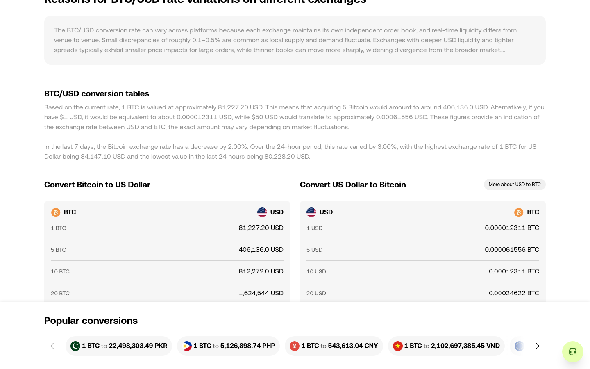

# 页面范围优先于 DFS：OKX 定向验收

2026-10-15，在 `119b99a` 基础上加入页面范围控制后，独立会话 `d4159405-5623-4533-9709-d810911b3241` 验证公开 BTC/USD → USD/BTC 导航。目标是确认目的页在未获准时不会吞掉探索预算，并能返回入口页；本轮不是整页覆盖测试。

使用通用 `scripts/exploration-workbench.ts`，保持新默认 `pageExploration: review`。上层启用 region 范围，仅选择已有原生链接 `More about USD to BTC`；基于当次观察中的 `/convert/usd-to-btc` 链接依据，审阅为公开页面跳转，未授予历史重放。其他入口页操作不在此定向批次内，未登录或提交交易。生产引擎没有新增 OKX 特例。

预算 15 次动作、深度 30、15 分钟、1 GiB 持久证据，均未触及。实际共 5 次成功动作：

1. 关闭 BTC/USD 的初始提示层。
2. 自动探索点击 `More about USD to BTC`，到达 USD/BTC。
3. 关闭 USD/BTC 的提示层，仅执行已识别出口。
4. 引擎自动执行已验证的原生历史返回，回到 BTC/USD。
5. 关闭返回后重新出现的 BTC/USD 提示层。

目的页产生独立 `kind: page` / `binding: context` 请求，仍为 pending。累计 537 个已观察成员是操作样本，**不是 537 个独立控件**；未放行任何目的页业务操作。最终仍关联目的页的 205 条待办全部 `not_attempted`；原有导航排除、区域失效等原因继续保留，没有被页面策略改写为已覆盖。

引擎停在 BTC/USD，原生返回事件明确 `stateRestored: false`，严格检查点恢复记录为 0。最终暂停为 PAGE_DECISION_REQUIRED；入口页区域在重载后也需要新决定，本轮没有宣称入口页穷尽。随后在已返回的状态将目的页改为 defer，动作数仍为 5；提交决定本身不执行操作。这验证页面授权材料能保留到返回后异步处理，普通区域及用途授权仍按各自条件失效。



[证据摘录](acceptance.json)保存各阶段会话、页面范围和返回链、完整 5 条动作的关键字段及前后观察、目的页未执行待办、审阅记录和持久事件。包含关闭后的数据库摘要和相关引擎源文件 SHA-256。原始证据位于 `work/page-scope-acceptance-final`，会话已关闭；事件直接从完整 SQLite 账本读取。

```sh
python3 docs/experiments/page-scope-2026-10-15/verify.py
```

该命令离线检查已提交摘录，不重跑网站。B → C 的独立批准、意外按钮导航、SPA query/hash 变化、异步指定样本、历史替换/副作用/排除导致的返回阻塞、初始重定向、普通范围失效与调试页决策，由独立测试覆盖。

页面边界目前以完整 URL 保守区分；业务视图不改变 URL、普通锚点与路由的区别、业务页面族聚合及环境重置仍是后续能力。原生返回不证明旧金额或服务器状态恢复，目的页 all 也不代表其链接目标获准。

最终验证：51 个文件 / 305 项测试全部通过（330.71 秒），其中新增页面引擎 16 项、调试界面 1 项。原有强制历史恢复用例显式采用旧跨页调度选项，保留原断言；新建会话的默认 review 另有回归。typecheck、build、smoke:built、新旧实测证据核查均通过。测试生成的通用截图及冒烟记录已还原。
