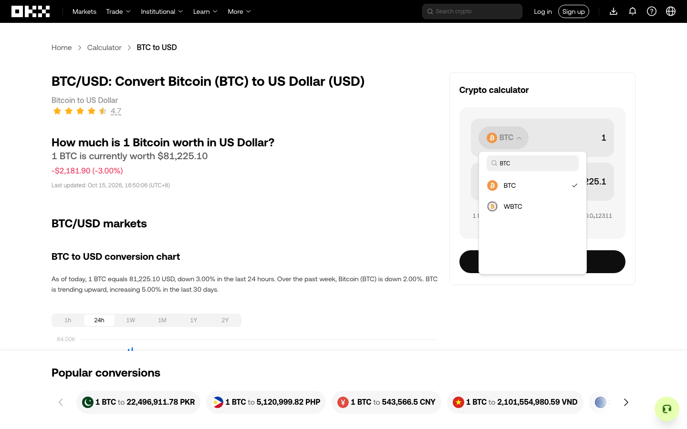

# 动态区域局部补审验收

基线：`ea45a38`（已合入并推送 main）。功能分支：`codex/region-incremental-review`。首轮使用真实 Chromium 的本地独立页面和调试页验证；随后在已推送的 `3ff43af` 上完成下述 OKX 有限实测。两者均不构成整页发现或穷尽证明。

## 已验证

- 图表区新增成员后，只补审图表，金额区原 all/sample/defer 决定、探索组及证据保持不变；新图表组待决。实际探索只执行金额区允许的操作，新成员在上层明确选择后才执行。
- 连续多次局部补审后仍引用各区域实际确认时的历史观察；移除、成员含义变化、容器替换分别报告。
- 过期观察/基准、重复归属、冲突拒绝、非法撤销、现场变化均拒绝；非法划分不部分写入。
- 文档、URL 和业务上下文改变必须完整重新划分；返回旧条件不复活旧决定。
- 未提及的失效区域继续等待；旧记录兼容；完整替换仍退役全部旧区域决定。
- hook、持久事件、SDK/HTTP 和 UI 共用材料与提交契约；排队后的调用方对象修改不会改变提交。
- UI 只补审变化区域并保留其他区域决定，最终探索只执行已允许的金额字段。

## 验证记录

- 新增 12 项区域补审测试，扩充现有 UI 流程。
- [最终相关回归日志](regression.log)：6 文件 / 51 项通过，包括区域确认、动态读数、批量决策及外部接入。
- `pnpm typecheck`、`pnpm build`、`pnpm smoke:built` 通过；[构建产物烟雾记录](build-smoke.json)。
- 此功能未修改另一任务负责的结构列表识别、动态观察就绪或截图采集。

## OKX 真实页面：连续两次局部补审

2026-10-15，以全新独立会话 `edd93b81-1e7a-4638-bd70-a5836787eae4` 打开公开 [BTC/USD 转换页面](https://www.okx.com/convert/btc-to-usd)。全过程使用通用 workbench 和引擎命令，没有直接修改网页 DOM。源码在会话前后保持 `3ff43af`，哈希一致；与另一任务的价格页/筛选器实测分离。本轮只新增验收材料，没有修改引擎逻辑。

显式启用区域审阅，列表与目的页保留默认 review；预算 30 次动作、30 分钟、深度 40。独立上层 agent 根据当次截图、候选和控件材料决定区域、用途与抽样；每次提交使用当前观察与版本，没有机械替换旧引用。

关闭地区提示后，上层确认两个窄区域：图表的 6 个时段控件、换算器的 6 个可操作控件。图表仅选 `1h` 样本，换算器仅选 BTC 入口。引擎 DFS 先打开 BTC 面板，随后因出口探测未关闭面板而暂停。

| 真实变化 | 引擎报告的区域差异 | 局部补审结果 |
| --- | --- | --- |
| 打开 BTC 面板 | 换算器新增 8 个控件，原入口移出区域操作集合 1 个；图表 unchanged | 只更新换算器；新组 pending、无旧决定；搜索仍 awaiting_exploration_decision |
| 上层新增 `Search = BTC` 单样本后执行 | 首屏六项过滤为 BTC/WBTC；换算器新增 1、移出 6；图表 unchanged | 再次只更新换算器；新组仍 pending，上层随后明确 defer |

两次补审的**直接前后**，图表组 ID、revision、decisions、collection 完全相等；逐区域 `reviewId` 始终引用最初确认记录，不改成最近一次换算器审阅。打开面板本身会改变动作所处边界，图表累计成员此前已从 6 增至 12、revision 从 2 增至 3；这不是补审引起的重置，也不能据原 sample 决定声称图表已执行。活动面板仍阻止背景操作。

重复提交第一份旧补审请求，实际返回 `STALE_REGION_REVIEW`；拒绝前后的区域、组、观察和动作计数相等。最后在换算器/list 均 defer、图表保留原 sample 的条件下再次运行，动作仍为 6，停在 `ACTIVE_BOUNDARY_BLOCKED`。

六次派发依次为：Close、打开 BTC、再次点击 BTC 入口尝试退出、Escape、Search=BTC、Escape。均记录派发 succeeded，但后面三次退出尝试的观察仍有面板，**没有证明退出成功**。本轮没有点击币种选项，没有发生导航或图表操作，两个金额值保持不变。最终还有 193 个控件未分配区域，页面滚动未分配，完成审计为 blocked / exhaustive=false。会话已关闭。



[证据摘录](okx-acceptance.json)包含两次提交、前后区域与探索组、原始审阅来源、实际动作后的边界、持久事件、独立上层复核及源码/原始文件哈希。完整原始材料位于忽略目录 `work/exhaustion-goal/run-07`。离线核查：

```sh
python3 docs/experiments/region-incremental-2026-10-15/verify-okx.py
# 原始目录仍在本地时，同时核对文件哈希：
python3 docs/experiments/region-incremental-2026-10-15/verify-okx.py --raw work/exhaustion-goal/run-07
```

## 仍开放

当前按区域复用判断。一个区域变化后仍整体重新待决；区域内部成员级批准复用、自动接受结构演化、宽锚点依赖细分和跨文档补审未实现。

本次复现的实际阻塞是自定义币种面板缺少已验证的无选择取消路径，与之前[组件实测](../components-probes-2026-10-15/README.md)一致。下一优先项是通用取消/外部指定出口能力及退出后条件验证：单纯增加点击次数或把 succeeded 当作关闭都不能解决。点击空白处或选回当前币种的含义必须有证据或上层确认，不能由引擎猜测成通用安全取消。本轮未验证这两条路径，整页连续探索仍未完成。
