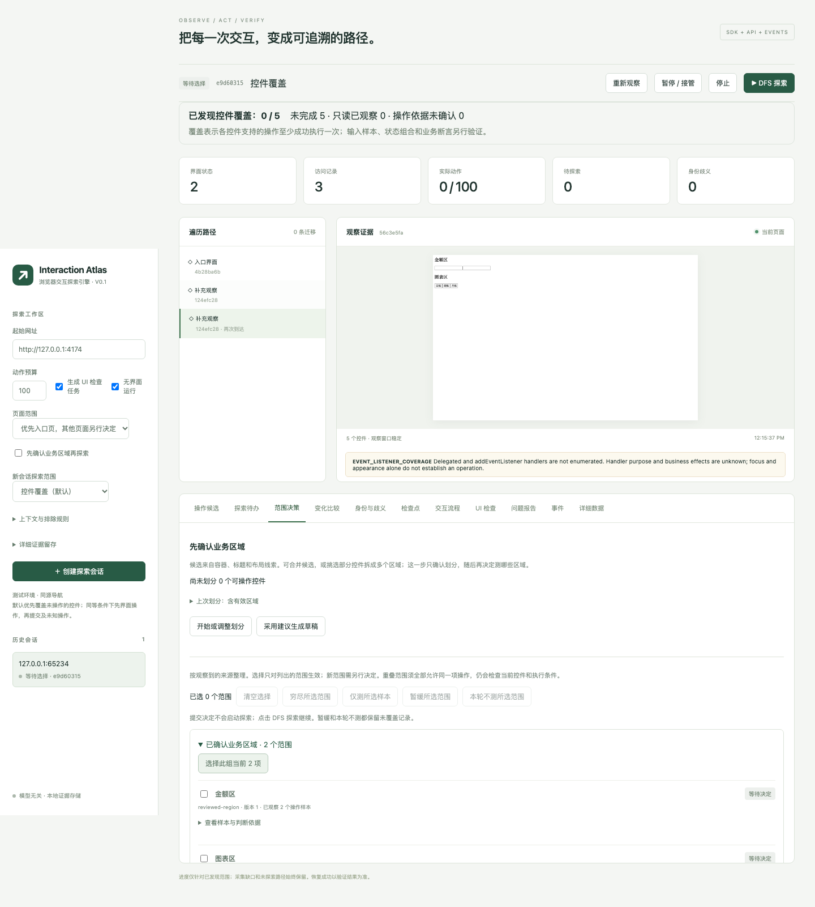

# 业务区域审阅：OKX 有限验收

2026-10-15，在 `48ad958` 基础上实现业务区域候选，以独立会话 `85ed02cc-5e0c-414a-bf15-28951234219b` 验证公开 BTC/USD 页面。使用通用 `scripts/exploration-workbench.ts` 调用引擎；候选采集没有站点名称、CSS 类名或业务标签规则，确认记录由外部审阅提供。

本次显式开启 `regionExploration: review`，列表与目的页维持默认 review，未开启可选 region/branch/input-space 生产者。预算 8 次操作、深度 30、10 分钟、1 GiB 证据。关闭初始提示使用已有的 Close 出口。

关闭提示后的材料包含 **61 个结构候选、203 个可操作控件**。候选按控件集合、标题和容器证据区分；这些数字不是业务功能数量，也不是覆盖率。

| 外部确认的区域 | 观察依据 | 成员 | 探索决定 |
| --- | --- | ---: | --- |
| Chart intervals | BTC/USD markets 标题及下方时间标签 | 6 | sample：仅 1W |
| Calculator | Crypto calculator 标题及金额输入、选择入口、转换链接 | 4 | defer |

确认生成两个待决的 reviewed-region 范围；确认和批量决定均未增加页面操作。启动 DFS 后只执行了 **1W**，记录 succeeded，后续观察中其 selected 为 `["1W"]`。其他五个时间标签未执行；换算器未执行操作，两个金额值分别保持 `1` 与 `81,038.4`。

引擎随后暂停为 **REGION_REVIEW_REQUIRED**：另有 193 个控件未划分，页面滚动也未被分配。两个已确认区域仍有效。总动作只有 Close 和 1W；没有发生填值、选择币种、转换提交或页面跳转。会话随后关闭。

[证据摘录](acceptance.json)保留候选及成员、两阶段审阅/决定、动作与前后控件、事件、源文件及原始记录 SHA-256。原始数据库、完整观察和截图保存在忽略目录 `work/region-review-acceptance-final`。此前 `work/region-review-acceptance` 仅是开发期间的候选探查，不属于最终源码验收。离线核查：

```sh
python3 docs/experiments/region-review-2026-10-15/verify.py
```

调试页在独立本地 HTML 中验证了建议草稿、观察更新后禁用旧草稿、重新读取新增控件、确认后独立选择探索策略。下图是本地用例，不是 OKX 截图：



此验收证明区域确认和有限样本执行闭环可用，不证明整页穷尽或业务断言正确。未知事件入口与 Canvas 内部内容仍是缺口。结构候选仍需上层确定业务意义；新增控件、虚拟列表窗口变化等会保守地使相关确认失效，后续需定义允许结构演化的契约。

最终验证：新增 18 项回归，完整 55 个文件 / 339 项测试通过（364.83 秒）；typecheck、build、smoke:built 通过。另以编译产物验证候选采集、确认、范围决定和仅执行获批区域。新旧实测证据离线核查通过，最终源码与已关闭会话的原始记录哈希均匹配。通用测试截图与冒烟记录已还原。
