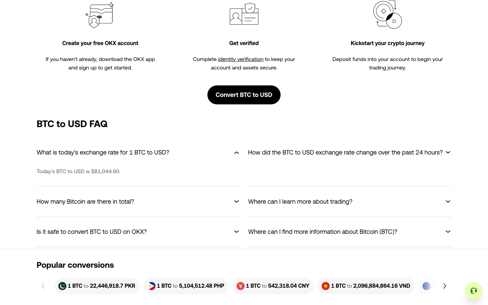

# 扩大探索范围与中部滚动遗漏修复

本轮先用已有协议补审换算器并扩大到 FAQ，实际执行金额、图表和 FAQ 样本；随后发现从页面中部开始的自动滚动会遗漏上半段。通用修复已在新分支 `codex/scroll-traversal-continuation` 提交为 `447f99a`，真实 OKX 新会话验证了页顶和页底之间连续重叠的观察区间。页面功能与发现完整性仍未完成。

## 范围扩展：run-10

2026-10-15，在固定源码 `0079309` 上打开公开 [BTC/USD 转换页](https://www.okx.com/convert/btc-to-usd)，会话 `a47430dc-adcc-48e5-b8dd-ba4fe33f6221`。所有操作通过通用 workbench 和引擎，独立上层 agent 基于每批当前材料决定范围；没有直接修改网页或用外部浏览器点击代替引擎执行。

初始仅确认图表与换算器。上层为 BTC 入口确认展开用途，为 BTC 金额字段声明有限样本 `2`，避免直接使用默认 `example` 字符串。图表只选 `1h`，换算器先只选入口，随后：

1. Close、打开 BTC、无选择退出，共 3 次动作。退出在指针移动后验证面板已消失，省略点击；关闭、父页面就绪和四个保留字段均通过。
2. 打开面板使换算器划分失效；退出并不自动复活旧划分。局部补审只更新换算器，同时新增独立 FAQ 区域；图表原组 ID、决定和审阅来源保留。未划分控件从退出后的 199 个降到 183 个。
3. 上层新批准金额 `2` 与首个 FAQ 问题。DFS 实际依次执行金额 → `1h` → FAQ；BTC 输入变为 `2`，USD 显示 `162,089.2`，`1h` 选中，FAQ `expanded=true` 且答案可见。这里只验证 UI 状态变化，不断言汇率或 Canvas 内容正确。



随后新增一个 `controlIds: []`、`pageTraversal: true` 的独立区域。第一份上层请求漏写必需的 `candidateIds`，被 schema 拒绝，观察、动作数和划分均保持原样；重新审阅并显式绑定当前整页候选后才接受。新区域只决定滚动，不放行它的任何后代控件。

批准遍历组 `all` 后，新增 7 次动作全部为页面滚动，但位置为：

```text
3569 → 4244 → 4919 → 5594 → 6269 → 6879 → 6204 → 6879
```

最终共 13 次成功动作，停在 `REGION_REVIEW_REQUIRED`，四个区域仍 active，未划分 183 个控件。到过页底并没有完成页面遍历：专用滚动阶段未到顶部，中部以下反向一段后又折返。旧位置的未尝试滚动意图按现有规则退役为 `traversal_position_changed`，不应恢复历史业务状态来补这些旧动作。

## 程序修复

独立静态测试页在页面、纵向容器和横向容器三种中部起点上都复现了遗漏，见[修复前失败记录](before-regression.log)。根因是每次生成当前滚动候选后，默认正向顺序会打断刚开始的反向遍历；再回已尝试的边界位置时，没有剩余当前动作可继续。

修复只改变 controls 模式下已经获准、属于当前观察且指向同一滚动区域的候选顺序：若最近一次成功滚动在完整前后观察中产生单轴移动，且文档、URL、上下文、弹层和当前视口仍吻合，优先延续该方向。到达边界后选择现有其他候选。非滚动工作和其他滚动区域保留原优先位置，上层 choose hook 仍可覆盖默认顺序。

失败或未知动作、缺失证据、新文档/上下文/边界、外部位移、视口尺寸变化均不沿用旧方向。没有新增批准、重放或覆盖权限，也没有放宽现场执行校验。旧滚动意图继续保留为未执行历史，不把坐标变化当作业务恢复。

## 固定修复版本复验：run-11

源码 `447f99a`，独立会话 `7e3e0d78-4d94-414c-8f6a-7230a7d744ea`。独立上层重新审阅 Close、FAQ 区域和唯一 FAQ 样本，DFS 打开答案并通过正常目标定位进入 `y=3569 / maxY=6879`。这次只验证滚动修复，没有重新批准图表和换算器。

在新观察中增量新增空控件的页面遍历区域，再单独批准其 `all`。两个 traversal keys 是上下方向，不能解释为只允许两次动作。实际新增 27 次页面滚动：

```text
3569 → 4244 → 4919 → 5594 → 6269 → 6879
     → 6204 → 5529 → 4854 → 4179 → 3504 → 2829 → 2154
     → 1479 → 804 → 129 → 0
     → 675 → 1350 → 2025 → 2700 → 3375 → 4050 → 4725
     → 5400 → 6075 → 6750 → 6879
```

总计 29 次动作均成功，新增阶段没有 click/fill/hover、容器滚动或导航；没有历史检查点恢复。实际到达顶部和底部，所记录视口区间连续重叠，原 FAQ 决定保留。最终仍因其他范围待审而暂停，195 个控件未划分，完成审计 `blocked / exhaustive=false`。两个会话批准的区域不同，195 与 run-10 的 183 不能作为同一范围的覆盖增减比较。

两次会话均已关闭，运行前后产品源码哈希一致。没有在运行中的会话切换源码，也未把旧批准移植到新实例。

## 验证与限制

- 新增 12 项专项检查：[专项日志](focused-regression.log)，覆盖三种真实滚动视口、权限输入集合保持和旧方向失效条件。
- 区域、局部补审和目的页门控：[48 项相关回归](gates-regression.log)通过。
- 固定源码 `447f99a` 的[全量回归](regression.log)：78 文件 / 582 项通过。类型检查、构建和构建产物烟雾检查通过，见[烟雾记录](build-smoke.json)。
- [证据摘录](okx-acceptance.json)保留两次会话的观察、动作、区域/组决定、拒绝命令、事件、独立复核、源码及原始文件哈希。原始目录为忽略目录 `work/exhaustion-goal/run-10`、`run-11`。

```sh
python3 docs/experiments/scope-traversal-2026-10-15/verify-okx.py
python3 docs/experiments/scope-traversal-2026-10-15/verify-okx.py --raw-root work/exhaustion-goal
```

滚动区间经过不等于链接或控件已操作，也不证明没有遮挡、Canvas 内部已检查或任意动态页面已完整发现。本次没有消除未划分控件、其他待决组、结构扫描和身份缺口。仍可能存在重复滚动；本轮没有声称路径或证据成本最优。下一步继续按上层目标扩展导航、转换表和页脚等区域，并分别审阅样本、目的页及返回条件；更复杂抽样、区域内成员判断复用与恢复成本优化仍开放。
